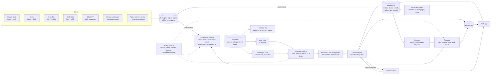
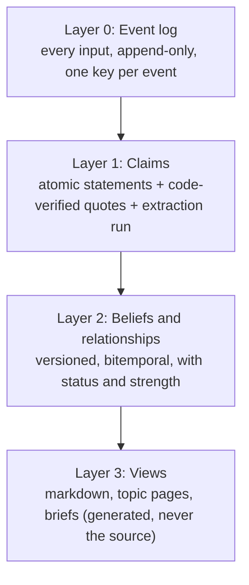
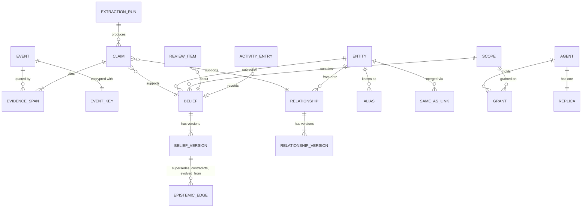
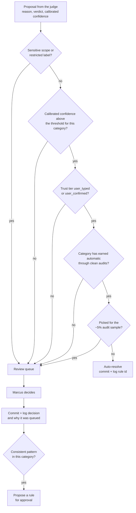
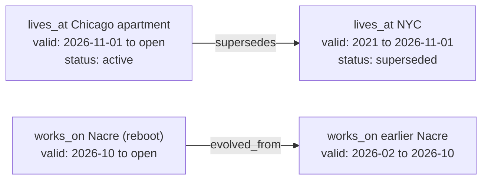
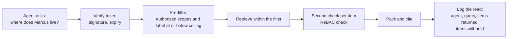
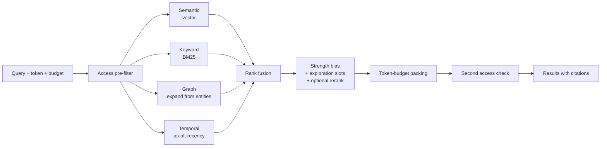
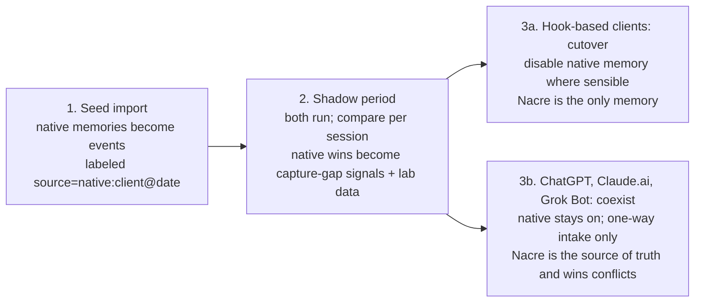
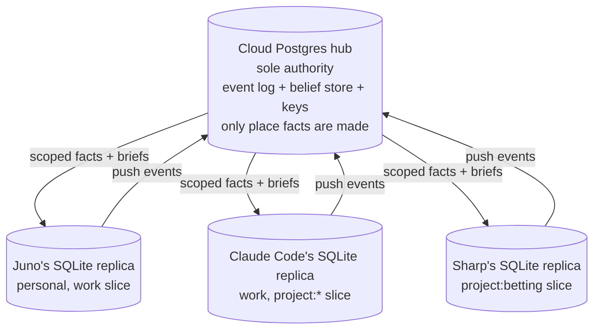

# Nacre: design document

*Status: draft v0.2.4, Oct 23, 2026 (America/Chicago). Owner: Marcus Schimizzi. v0.1 (Oct 20) is kept as `design.md.v1.bak`, v0.2 as `design.v0.2.bak.md`, v0.2.1 as `design.v0.2.1.bak.md`, v0.2.2 as `design.v0.2.2.bak.md`, and v0.2.3 as `design.v0.2.3.bak.md`. v0.2 folded in Marcus's decisions of Oct 21, 2026, which resolve most of v0.1's open questions.*

**Changelog**
- **v0.2.4, Oct 23, 2026.** §17: slice 1 now includes a minimal single-user OAuth 2.1 server for MCP clients (Decided by Marcus), because Grok Bot's connector supports only OAuth; static bearer tokens stay for Claude Code. Slice 5 keeps OAuth scopes, per-agent grants and more clients. Slice 1's exit check is now 17 acceptance tests. Details in `slices/slice-1-spec.md` v0.2.5 §9.3.
- **v0.2.3, Oct 21, 2026 (8 PM).** §7.6 and §9.8: normal content may now go to Anthropic's official endpoint (`api.anthropic.com`), on the same terms as OpenAI and TypeSafe (Decided by Marcus). §17: slice 1 uses OpenAI only, and the Anthropic adapter arrives with the slice 2 Haiku 5.5 trial, behind the swappable `Extractor` interface.
- **v0.2.2, Oct 21, 2026 (evening).** Slice 1's models are Decided ("at least for now"): `gpt-6-luna` for extraction and `text-embedding-3-small` for embeddings (§5.7). Claude Haiku 5.5 (Anthropic) is the named slice 2 lab challenger, with `gpt-5.6-luna` as the fallback (§17). §9.8 notes that the Haiku trial needs Anthropic's official endpoint approved for normal content.
- **v0.2.1, Oct 21, 2026.** Folded in Marcus's answers to the slice 1 spec's open questions (`slices/slice-1-spec.md` §17). §4.2 and §5.2: pasted secrets are now stripped from the stored event body, the one exception to "events unchanged". §5.3: assistant turns are stored but not mined in slice 1. §5.7: the API budget is $0.50/day for online work only (extraction and embeddings); heavy work is subscription-backed through the local-agent job contract. §15.7 (new): planned lab experiment on mining assistant turns. §16: new item 10. §17: replaced the phased roadmap with the 8 vertical slices.
- **v0.2, Oct 21, 2026.** Marcus's Oct 21 decisions.
*This is the reference document. The deck (`deck.html`) and the explorable (`explorable.html`) in this folder are companions to it. When they disagree, this file wins. Three research notes in this folder feed it: `engine-study.md` (how Graphiti and Hindsight work), `decision-models.md` (Jev, the OpenAI Decisions API and alternatives) and `relationship-types.md` (the core relationship list).*

> **Bottom line**
> 1. **Nacre** is one memory, shared by all of Marcus's agents (Claude Code, Codex, Claude, ChatGPT, Grok Bot, Grok Build and others), at least as good as their native memories. It is always the **source of truth**. Native memories are **supplemented, never written to**: they flow in one way, as lower-trust input.
> 2. The source of truth is an **append-only event log** on a **cloud Postgres hub**. Only the hub turns events into facts. Each agent has its own scoped local copy that works offline and pushes later; late events are placed by when they happened and the affected facts are replayed.
> 3. Memory is built in layers: events → **claims with quoted, code-checked evidence** → **versioned, bitemporal beliefs and relationships** → generated views. We **build our own core** and borrow ideas only after studying them.
> 4. Models **propose**; code decides. Clear cases resolve automatically, and a category earns automation only through **clean random audits**. Everything else goes to a **daily 10–20 minute review queue**. Nearly everything is reversible, and only Marcus can **purge**, which destroys an event's key so its content is unreadable everywhere.
> 5. New agents start with **no access**. Private and restricted content never goes to hosted models. A **memory lab** replays every rule, prompt or model change on Marcus's own history before it goes live.

**How to read the labels.** **Decided** means a settled decision (most of them dated Oct 21, 2026). **Proposed** means a recommendation that is not decided yet. **Open** points to §16. Research claims carry a source tag such as [S6], from the source list at the end, which comes from `/workspace/memory-landscape.md` (sources loaded Oct 19, 2026). "Nacre review" means `/workspace/nacre-review.md`, a review of the **earlier Nacre project**; "landscape §N" means a section of the landscape report. `engine-study §N`, `decision-models §N` and `relationship-types §N` point to the companion notes in this folder. All examples about Marcus's life (Chicago lease, NYC, agent names and scopes) are **example data**.

---

## Skip to answers

| Question | Short answer | Section |
|---|---|---|
| What is it called, and why? | Nacre: mother-of-pearl, which is strong because it is laid down in thin layers over time | §1.6 |
| Build or adopt Graphiti/Hindsight? | Build our own core. Borrow specific ideas only after studying them; any borrowed part is a temporary bootstrap | §3.5 |
| How do devices sync? | Cloud Postgres hub is the only authority and the only place facts are made. Per-agent SQLite replicas write events offline and push later | §12 |
| What happens to a late event? | Placed by when it happened; affected entities are replayed from that point; flipped facts go to review labeled "late arrival" | §12.3 |
| Can something truly be deleted? | Only by Marcus, with a purge: the event's own key is destroyed, a tombstone stays, derived facts are rebuilt | §14.3 |
| Can a wrong merge be undone? | Yes. Merges are reversible `same_as` links; splits re-sort facts by their quoted evidence | §8.4, §14.2 |
| Who decides a contradiction? | A judge proposes (reason first, then verdict); a code policy routes it; Marcus decides the gray ones | §7 |
| When does a category go automatic? | When enough random audits come back clean: zero errors in n audits bounds the error rate at about 3/n | §7.5 |
| Do we use Jev or OpenAI Decisions? | A limited trial behind one interface. Jev first, OpenAI once for comparison. Never for private content | §7.6 |
| Is anything thrown away by salience? | No. Borderline items are kept as low-strength memories; usage changes strength, never whether something is kept | §6 |
| Does recall reinforce itself? | Only "retrieved and used" counts, mildly, capped per day and shared; small exploration slots fight crowding-out | §6.3 |
| Do we write back to ChatGPT/Claude/Grok Bot memory? | No. One-way intake only | §1.3, §11.4 |
| What does consolidation cost? | Incremental, cheapest model first, nightly budget, at most about $20/month for now | §5.7 |
| What is still open? | Ten items | §16 |
| In what order is it built? | 8 vertical slices, each a working product; slice 1 has a build spec | §17 |

---

## Contents
1. Purpose, first milestone and name
2. Principles
3. Architecture overview (including build vs. adopt)
4. Data model
5. Write path (including consolidation cost)
6. Salience and strength
7. Conflict resolution, the review queue and decision models
8. Relationships and evolution over time
9. Access control
10. Retrieval (recall)
11. Integration with each agent
12. Sync and multi-device
13. Visualization app
14. Activity log, reversibility and privacy purge
15. Memory lab
16. Open questions
17. Roadmap: 8 vertical slices
- Appendix A: worked example (the Chicago lease)
- Appendix B: glossary
- Sources

---

## 1. Purpose, first milestone and name

### 1.1 Purpose
Marcus works with many agents. Each keeps its own memory, and the memories do not talk to each other: a preference Claude Code learned is invisible to ChatGPT, and a fact Grok Bot learned is invisible to Codex. Native memories are also hard to inspect. You can't easily see why one was saved, where it came from, or what it replaced. In some products the memory cannot be read or written programmatically at all [S43, S45, S47, S48].

Nacre is one memory that Marcus owns, which every agent reads from and writes to through a controlled interface. It should be:

- **Shared.** A fact learned in one agent is available to the others that are allowed to see it.
- **Traceable.** Every remembered fact points to the exact words it came from, the agent that captured it, and the model and prompt that extracted it.
- **Current.** When facts change, memory records the change. It does not overwrite.
- **Governed.** Marcus decides which agent sees what, and every read is logged.
- **Measurable.** Changes to the system are tested against Marcus's own data before they ship.

### 1.2 First milestone (Decided)
**One centralized memory shared by all of Marcus's agents, at least on par with their native memories.**

"On par" means the table-stakes behaviors the research found across native memories [landscape §1]:

| Area | Native behavior to match | Source |
|---|---|---|
| Capture | Automatic background extraction after a turn or when a session goes idle, plus explicit "remember X" | Grok Build [S54], Codex [S50] |
| Capture hygiene | Skip what the source of truth already holds (code, docs); redact secrets; gate sensitive categories; keep tool- or web-tainted sessions out of capture | Claude Code [S52], Codex [S50], Claude [S46] |
| Organization | A small always-loaded index (about 200 lines / 25 KB is the de-facto budget), topic detail on demand, project vs global memory | Claude Code [S52] |
| Freshness | Time-aware rewriting ("going to Singapore" becomes "went to Singapore in July 2026") and periodic consolidation | ChatGPT Dreaming [S20, S43] |
| Controls | View, edit, delete per item; "don't mention this again" (suppression without deletion); memory off per session; pause; export | ChatGPT [S44], Claude [S45] |
| Transparency | Show which memories shaped an answer | ChatGPT Sources [S44] |

Nacre must also do things native memories do not: work across agents, keep full history, show provenance for every fact, and enforce per-agent access.

### 1.3 Stance on native memory (Decided)
Nacre is **always the source of truth** and wins every conflict with a native memory. Native memory is **supplemented, not improved**: Nacre reads from it and never writes to it.

1. **Seed import (all clients).** Import each native memory once as evidence, labeled with its origin (for example `source=native:chatgpt@2026-10-05`).
2. **Shadow period (all clients).** Both run. For each session, compare what native memory captured or recalled with what Nacre did. When native memory wins (it caught something we missed, or recalled something better), log it as a **capture-gap signal** and add it to the memory lab as test data.
3. **Then, per client:**
   - **Clients with hooks (Claude Code, Codex, Grok Build and similar): cutover.** Disable native memory where the product allows it and where it makes sense. From then on, Nacre is the only memory there.
   - **ChatGPT, Claude.ai and Grok Bot: coexist and supplement.** Their native memory stays on. It is **one-way intake only**: native items arrive as source-labeled, lower-trust events, and a native item that matches an existing fact attaches to it as an extra source instead of creating a duplicate (§11.4). Nothing is ever written back into native memory, so there is no outbound sync and no echo-tagging to stop our own output from coming back in.

Hooks, MCP connectors and session-start injection are the **permanent** integration layer. They are not a bridge.

### 1.4 The hardest problem (Decided)
The hardest problem is the **write path**: capturing salient, high-quality memories with traceable provenance, clearly modeled relationships and sensible evolution over time. Reads can only surface what writes stored well. The research also found that no public memory lab measures write-path quality directly [landscape §0]. Most of this document's detail goes to the write path for that reason.

### 1.5 Non-goals for milestone 1
- Ingesting Marcus's wider data footprint (all email, Slack, documents) ahead of time, the way Adapter does [Adapter report §2]. Agents can still log tool results as events, but bulk connectors come later.
- Multi-user sharing. Nacre has one human principal, Marcus.
- Storing memory in model weights or KV caches (MemOS-style parametric memory [S37, S38]).
- Device-to-device sync without the cloud hub (§12).

### 1.6 Name (Decided)
The platform is called **Nacre**. It is a ground-up reboot of Marcus's earlier Nacre project and a clean new major version: it reuses the name, not the design. Nothing in the earlier codebase's schema, roadmap or storage format binds it. Where this document borrows from the earlier project, it says so and cites the Nacre review.

**Why the name fits.** Nacre is mother-of-pearl. A mollusk builds it by laying down thin layers, one on top of another, over years. It is tough because it is layered, and every layer stays visible in the finished surface. That is this design: an append-only log that only ever adds a layer, claims and beliefs built on top of it, and a history you can still see through.

---

## 2. Principles

1. **Never throw anything away, unless Marcus purges it.** Every input stays as an event. Salience decides how strongly something is remembered, not whether the input survives. Corrections, supersessions and merges add records; they never delete earlier ones. The only true deletion is a purge that Marcus triggers himself (§14.3).
2. **Evidence before belief.** A belief exists only because one or more claims support it, and each claim quotes its source span. Code checks that the quote really is in the source. No verified quote, no belief.
3. **Two clocks on everything.** Keep *valid time* (when it was true in the world) separate from *record time* (when memory learned or stopped believing it) [S6]. Events also carry two arrival clocks: when it was said (device time) and when the hub received it (§12).
4. **Views are generated, never edited as truth.** Markdown pages, topic files and briefs are rebuilt from beliefs. A human edit to a view flows back as a `user_edit` event [landscape §6].
5. **Models propose, code commits.** Models extract claims and suggest resolutions, with a reason written before the verdict. A deterministic commit step applies policy and writes. This keeps the commit step reproducible and testable (an idea from the earlier Nacre's "no LLM on the hot path" [Nacre review §5]).
6. **Ask Marcus about the gray areas, and learn from his answers.** Ambiguous, low-confidence and sensitive changes go to a review queue. Patterns in his decisions become *proposed* rules; nothing is adopted silently.
7. **Least privilege, default deny.** New agents start with no access. Each scope is granted individually. Tokens are narrow, never master keys.
8. **Log everything, make nearly everything reversible.** Every change and every read is logged. Merges, splits, supersessions, rules and retractions can all be undone.
9. **Measure before shipping.** Every change to rules, prompts, weights or models is replayed in the memory lab with a before/after diff.
10. **Plain over clever.** Prefer one boring database and explicit tables over exotic infrastructure until the lab shows a need.
11. **Never design the system around specific memories.** Examples illustrate; they never become schema rules. The schema records what evidence says and does not police how anyone's life is shaped (relationship-types §6).

---

## 3. Architecture overview

### 3.1 Components

| Component | What it does |
|---|---|
| **Adapters** | Per-client glue: hooks (Claude Code, Codex), MCP connector (all clients), shared skills (Grok Bot), importers (native memory, chat exports). They send events in and request briefs and recall out. |
| **Local replica** | One scoped SQLite copy per agent. Holds the agent's authorized slice for fast reads, and queues events while offline. It never turns events into facts (§12). |
| **Gateway** | One API and MCP server at the hub. Authenticates the agent's token, checks write scopes, stamps provenance and hub-received time, appends events. OAuth 2.1 at the edge for MCP clients [S75a]. |
| **Event log** | Append-only. The system of record. Each event is encrypted with its own key (§14.3). |
| **Fast pass** | In-session, cheap. Scores salience generously, extracts candidate claims, resolves entities, proposes changes. |
| **Overnight pass ("dreaming")** | Incremental consolidation within a nightly budget (§5.7). Re-scores, re-extracts, links entities, finds conflicts, proposes **changesets** with diffs. Can be run by Marcus's own local agents under a job contract (§5.8). |
| **Decision service** | One interface (yes/no, choice, score) with swappable backends: rules, Jev, OpenAI Decisions, Cloudflare Clef, local classifiers, an LLM judge (§7.6). |
| **Commit engine** | Deterministic. Applies policy to proposals: auto-resolve, queue, or hold. Writes beliefs, relationships and log entries. Runs replays for late events (§12.3). |
| **Belief store** | Entities, claims, versioned beliefs and relationships, strength. Bitemporal. |
| **Indexes** | Vector, keyword (BM25), graph adjacency, temporal. Rebuildable from the store. |
| **Key service** | Holds one key per event. Destroying a key is how a purge works (§14.3). |
| **Policy service** | Scopes, sensitivity labels, relationship-based permissions, token verification, and the rule for what may leave for hosted models (§9.8). Consulted on every read and write. |
| **Review queue** | Items waiting for Marcus, with reasons, choices and rule proposals. Its first interface is the labeling tool (§13.3). |
| **Activity log** | Every change, read and replay. Supports search and undo. |
| **Views** | Generated markdown, topic pages, per-scope briefs, context packs. |
| **Web app** | Today home, timeline, graph explorer, entity pages, activity log, review queue, labeling tool. |
| **Memory lab** | Gold set, replay harness, scorecards, release gate, backend comparisons. |

### 3.2 System diagram



### 3.3 The layers



This is the shape the field converged on in 2026: an append-only raw layer, an extracted fact layer linked to entities, asynchronous consolidation, and hybrid retrieval [landscape §0; S20, S24, S26, S33, S35]. The difference here is the explicit split between **claims** (what a source said) and **beliefs** (what memory currently holds true). The earlier Nacre lacked that split on main [Nacre review §6]; Hindsight approaches it with evidence-backed observations, but its belief layer is mutable prose (engine-study §4.2).

### 3.4 Storage (Decided)
One Postgres database at the hub, with pgvector for embeddings and plain tables for the graph. The research notes a trend toward single-Postgres systems (Cognee "Just Postgres" [S18], Hindsight on Postgres + pgvector [S33]). A dedicated graph database is not needed at personal scale. Revisit only if the lab shows graph queries are a bottleneck. Local replicas are covered in §12.

### 3.5 Build vs. adopt (Decided: build our own core)
We **build our own core**. We do not adopt a full off-the-shelf engine (Graphiti or Hindsight), because of **lock-in** and **assumption risk**: both engines bake in choices that clash with ours where it matters most. Graphiti closes old facts silently and in place, with no reason and no review; Hindsight never closes raw facts but rewrites or hard-deletes its derived beliefs; neither keeps quoted evidence or can undo a merge (engine-study bottom line, §4.5, §7).

**Borrowing rule (Decided).** An idea is borrowed only after we understand it deeply: we have read the code, know its failure cases, and have a lab test for it. Any borrowed **component** (as opposed to an idea) is a **temporary bootstrap** with a written plan to improve or replace it, tracked in the lab.

**What we borrow (Decided):**

| Idea | From | Where it lands |
|---|---|---|
| Two-step extraction: entities first, then facts between those entities | Graphiti (engine-study §2.1, §8.1) | §5.2 |
| Entity-resolution ideas: exact → fuzzy → model only for the leftovers; entropy gate for short names; differing numbers block a merge; co-occurrence as a review-card signal | Graphiti, Hindsight (engine-study §3, §8.2) | §5.2, §8.4 |
| Date handling: a date range plus a precision label ("July 2026" spans the month, `precision=month`); "when said" kept separate from "when received" | Hindsight (engine-study §2.2, §4.2 rule 10) | §4.2, §4.3 |
| Prompt rules: pronouns and kinship ("Nisha's dad"), future-tense regex guard, "cannot both be true", no computation | Graphiti, Hindsight (engine-study §8) | §5.2, §7 |

**What we fix from the engine study (Decided):**
1. **Find conflicts by looking up the same subject and attribute (or relationship type), not by searching the whole graph.** Every active fact for that subject and attribute is compared, however many old values exist. This fixes both Graphiti #1728 (unrelated facts closing each other) and #1956 (the current fact missed after about 10 old ones). Text similarity is only a safety net for claims whose attribute is unknown, and it never spans the whole graph.
2. **The contradiction judge writes its reason, then its verdict, and proposes rather than applies.** A reason-first field restored a small model's contradiction accuracy from 7/15 to 14/15 in Graphiti #1666. The judge's output is a proposal that goes through the commit engine's policy (§7.2).
3. **Quotes are verified in code against the source.** If the quoted span is not found in the event text, the claim is `held`, not promoted. Both engines paraphrase, so neither can show the exact words.
4. **Date precision is stored** (§4.3).
5. **Retractions re-derive beliefs and reopen anything they closed** (§5.4). Graphiti leaves invalidations in place after an episode is removed (engine-study §4.4).

---

## 4. Data model

### 4.1 Overview



### 4.2 Event (Layer 0)
Every input, unchanged, **except for pasted secrets** (see below). Messages, tool results, imports, user edits made in the app, review decisions, retractions, purges and system actions (consolidation runs, replays, rule changes) are all events.

**Exception: secrets are redacted before storage (Decided, Oct 21, 2026).** API keys, passwords, tokens and similar secrets are stripped from the content at ingest, before it is hashed or stored, and replaced with a `[REDACTED:<kind>]` marker. The kinds and counts are recorded on the event (`redactions`). Marcus's reasoning: a memory should never contain an actual secret, so the stored event is the raw input minus its secrets. Nothing else is ever removed or rewritten. This applies from slice 1 (`slices/slice-1-spec.md` §6.2).

| Field | Meaning |
|---|---|
| `event_id` | `evt_…`, unique |
| `kind` | `message`, `tool_result`, `import`, `native_intake`, `user_edit`, `review_decision`, `retraction`, `purge`, `system` |
| `source_client` | `claude-code`, `codex`, `chatgpt`, `grok-bot`, `importer:chatgpt-export`, … |
| `source_label` | Origin label for imported or native items, such as `native:chatgpt@2026-10-05` |
| `agent_id` | The agent identity that sent it (for example `juno`) |
| `replica_id`, `device_seq` | Which local replica wrote it, and its sequence number there. Used to push, dedupe and order offline writes (§12) |
| `principal` | Always Marcus for now |
| `session_id` | Client session, if any |
| `observed_at` | **When it was said**: the device clock, with time zone. Used to place the event in time ("recency is when it was said, not when it arrived", Hindsight rule 10, engine-study §4.2) |
| `received_at` | **When the hub received it**: the hub clock. Never set by a client |
| `clock_flags` | `drift` (device clock disagrees with the hub by more than a tolerance), `future` (observed_at is later than received_at), `late` (arrived after the hub had processed later events for the same entities) |
| `key_id` | The event's own encryption key (§14.3) |
| `content` | The raw payload with secrets redacted, encrypted with the event's key |
| `redactions` | Kinds and counts of secrets stripped at ingest, e.g. `[{"kind":"api_key","count":1}]` |
| `content_hash` | A keyed hash (HMAC under the event key) for dedup and integrity. It becomes meaningless once the key is destroyed, so a purged secret can't be guessed from its hash (Proposed) |
| `scope_hint` | The scope the client suggests; policy may override |
| `sensitivity` | `normal` / `private` / `restricted` (client hint and classifier; stricter wins) |
| `trust_tier` | `user_typed` > `user_confirmed` > `agent_inferred` > `native_memory` > `tool_or_web_derived` [landscape §3.1]. `native_memory` is new in v0.2 for one-way intake (§11.4); its exact place in the order is Proposed |
| `tainted` | True if the session included untrusted external content (after Codex's `disable_on_external_context` [S50]) |

Events are never updated. A correction or retraction is a new event that references the old one. A purge is the one exception to "the content stays": it destroys the key and leaves a tombstone (§14.3). Secret redaction is not an update: it happens once, before the event is first written.

### 4.3 Claim (Layer 1)
An atomic statement that a source made, plus the evidence for it.

| Field | Meaning |
|---|---|
| `claim_id` | `clm_…` |
| `text` | Normalized natural language: "Marcus signed a lease for an apartment in Chicago." |
| `structured` | Optional triple(s): `(marcus, signed_lease_for, chicago_apartment)` |
| `subject_entity_id` | Resolved entity |
| `assertion_type` | `stated`, `inferred`, `preference`, `instruction`, `plan`, `decision`, `hypothesis`, `quoted_third_party` [landscape §3.2; relationship-types §4] |
| `valid_from`, `valid_to`, `valid_precision` | When the claim says it is true in the world, as a **date range plus a precision label** (`day`, `week`, `month`, `year`, `unknown`). "July 2026" is 2026-07-01 to 2026-07-31 with `precision=month`, never 2026-07-01 alone (Hindsight's coarse-date rule plus a precision field, engine-study §4.3) |
| `time_source` | `explicit`, `relative` (grounded against `observed_at`), or `inferred_from_event_time` (engine-study §8.1) |
| `evidence[]` | One or more `{event_id, span_start, span_end, quote}`. The extractor supplies the quote; **code finds it in the event text and records the offsets**. A quote that is not found makes the claim `held` and is logged as an extraction error |
| `extraction_run_id` | Which run produced it (model, prompt version, config hash) |
| `confidence` | Extractor's confidence, 0–1, with a reason |
| `salience` | Promotion score, feature values and reason labels (§6) |
| `scope_id`, `sensitivity` | Inherited from the event, possibly raised |
| `status` | `candidate`, `promoted`, `held` (below threshold or unverified quote), `queued`, `rejected`, `retracted` |

Claims are never edited. A better extraction produces a new claim with a new run ID.

### 4.4 Belief and belief versions (Layer 2)
A **belief** is Nacre's current position on one question whose answer is a **literal**: a date, number, string or description. "When is Dana's birthday?", "Which package manager does Marcus prefer?" Each change creates a new **version**. A fact whose value is an **entity** (a place, a person, a project) is a **relationship** instead (§4.6). That is the storage rule from relationship-types §4 (Decided): if the value is an entity, it is a relationship; if it is a literal, it is a belief. A fact is never stored twice.

| Field | Meaning |
|---|---|
| `belief_id` | `blf_…`, stable across versions |
| `version_id` | `blv_…`, one per change |
| `subject_entity_id`, `attribute` | For example `ent_marcus`, `preferred_package_manager` |
| `value` | "pnpm" |
| `kind` | `ordinary` or a **durable kind** (`preference`, `decision`, `birthday`, …), which decays slowly or not at all (§6.3) |
| `cardinality` | `one` or `many`. Only for literal-valued beliefs (a birthday is `one`; nicknames are `many`). Relationships never use cardinality (§8.2) |
| `valid_at` / `invalid_at` | **Valid time**: when this was true in the world, each with its precision |
| `created_at` / `expired_at` | **Record time**: when memory started and stopped holding this version |
| `status` | `active`, `superseded`, `disputed`, `retracted`, `suppressed` |
| `supporting_claims[]` | Claim IDs, each with its verified quote. Native items that match attach here as extra sources (§11.4) |
| `confidence` | Combined from supporting claims and trust tiers |
| `strength` | How much it counts in recall right now (§6.3) |
| `reason_labels[]` | Why it was kept, especially for low-strength borderline memories (§6.2) |
| `scope_id`, `sensitivity` | Where it lives and how protected it is |
| `provenance` | See §4.8 |
| `committed_by` | `rule:<id>`, `review:<item id>`, `replay:<id>`, or `user_edit` |

The four timestamps follow Graphiti's bitemporal model, where edges are invalidated rather than deleted: `valid_at`/`invalid_at` for the world, `created_at`/`expired_at` for the system [S6]. Two questions this makes simple:

- *What was true on date D?* Versions where `valid_at ≤ D` and (`invalid_at` is null or `D < invalid_at`).
- *What did memory believe on date D?* Versions where `created_at ≤ D` and (`expired_at` is null or `D < expired_at`).

**Version rows are immutable.** Ending or correcting something never edits a row in place. It closes the current row's record time (`expired_at = now`) and writes a new row with the corrected fields. This keeps "what did memory believe on date D" exact, because the row that was current on D is still there, unchanged. A future end date (`invalid_at` after today) leaves `expired_at` null; it is not "born expired" (Graphiti #2012, engine-study §6).

These are different questions. Memory may learn on Oct 18 that Marcus moved on Sep 1. On Sep 15 memory still believed he lived in NYC, though in the world he no longer did. The timeline view (§13) shows both. A late event (§12.3) is the same situation at a smaller scale.

### 4.5 Entities and aliases
| Field | Meaning |
|---|---|
| `entity_id` | `ent_…`, one ID per real thing |
| `type` | One of 10 entity types (Proposed, relationship-types §3): `person`, `organization`, `place`, `project`, `goal`, `agent`, `tool`, `artifact`, `event`, `topic` |
| `canonical_name` | Display name |
| `aliases[]` | Every name it has been called, each with its first evidence |
| `same_as[]` | Reversible merge links (§8.4). A merged ID stays as a redirect |
| `split_into[]` | History of splits |
| `pending_identity` | For kinship placeholders such as "Marcus's dad" until a name is linked (engine-study §8.2) |
| `external_ref` | For projects and goals mirrored from Wake, the Wake ID. Wake stays the authority on project state, threads and tasks (relationship-types §3) |
| `scope_id` | Most entities are in a shared scope; some (a health provider) are restricted |

Entity attributes that change are stored as versioned beliefs, not overwritten (Graphiti #1166).

### 4.6 Relationships (world edges)
A typed connection between two entities, such as `marcus —lives_at→ chicago_apartment` or `marcus —works_on→ nacre`. A relationship *is* a versioned fact, with the same lifecycle as a belief.

| Field | Meaning |
|---|---|
| `relationship_id`, `version_id` | Stable ID plus per-change versions |
| `type` | One of the **17 core types** (§8.2), or `related_to` as a holding state |
| `from_entity_id`, `to_entity_id` | The two ends |
| `qualifiers` | Typed per relationship type: `role`, `kinship`, `kind`, `polarity`, … (relationship-types §6.2). A qualifier change is a new version |
| `valid_at` / `invalid_at`, `created_at` / `expired_at` | Same four timestamps, with precision |
| `status` | Same as beliefs |
| `source` | Supporting claim IDs |
| `confidence` | 0–1 |
| `strength` | Same rules as beliefs (§6.3) |
| `scope_id`, `sensitivity` | As above. `sentiment` about people is a restricted qualifier |

A relationship **ends** by getting an `invalid_at`. It is never deleted.

### 4.7 Epistemic edges
Connections between beliefs, relationships and claims, kept separate from world edges, as the research recommends [landscape §3.1]:

- `supports`, `contradicts`: between claims and beliefs or relationships
- `supersedes` (shown as "replaced" in the app): a new version replaces an old one
- `evolved_from`: a fact that grew out of another ("works_on Nacre (reboot)" evolved from "works_on the earlier Nacre")
- `derived_from`: a consolidated fact built from several others
- `refines`: a more specific version of the same fact

### 4.8 Provenance (Decided: required on every belief and relationship)
Provenance is modeled on W3C PROV (Entity, Activity, Agent) [S76]:

| PROV concept | In this system |
|---|---|
| Entity | Events, evidence spans, claims, belief and relationship versions |
| Activity | Extraction runs, judge proposals, consolidation runs, replays, review decisions, user edits |
| Agent | The client agent (Juno, Claude Code), the model or decision backend (name + pinned version), the prompt (version + hash), and Marcus |

Every version can answer: *which exact words, in which event, from which agent, extracted by which model and prompt, proposed by which judge with what reason, committed by which rule or decision?*

This is also the main defense against memory poisoning. AgentPoison [S77] and MINJA (injection through queries alone) [S78] work by getting malicious content stored as memory. With provenance and trust tiers the system can (a) refuse to promote tool- or web-derived claims into instructions without confirmation [landscape §3.1], (b) find every fact that came from a suspect source, and (c) undo them as a group (§14.2).

### 4.9 Scopes, labels, grants
Covered in §9. Every event, claim, belief, relationship and entity has exactly one `scope_id` and one `sensitivity`.

### 4.10 Review items, rules, changesets, activity entries
Covered in §7, §5.5 and §14. Every review decision also stores the exact **state snapshot** shown to the decision backend, the **backend and pinned model version**, its raw probabilities, the system's suggestion, Marcus's choice and any edited value or date (decision-models §4.1). Without these, a decision can't be replayed and calibration can't be refitted after a model change.

---

## 5. Write path

### 5.1 Overview

```mermaid
sequenceDiagram
  participant A as Agent (e.g. Juno)
  participant R as Local replica
  participant G as Gateway (hub)
  participant E as Event log
  participant F as Fast pass
  participant D as Decision service
  participant C as Commit engine
  participant Q as Review queue
  participant B as Belief store
  participant L as Activity log
  A->>R: event (device time)
  R->>G: push when online (token, scope hint)
  G->>G: verify token, check write scope, stamp provenance + received_at
  G->>E: append evt_ (encrypted with its own key)
  alt arrived late
    E->>C: replay affected entities from observed_at
  end
  E->>F: new event
  F->>F: salience; entities, then facts; verify quotes; ground dates
  F->>D: same subject + attribute candidates
  D->>C: proposal (reason, then verdict, calibrated confidence)
  C->>C: apply routing policy (code)
  alt clear, safe, category automatic
    C->>B: commit new version (bitemporal)
    C->>L: log change (rule id, evidence, old and new value)
  else gray, low-confidence, sensitive, or audit sample
    C->>Q: queue with reason
    C->>L: log "queued"
  end
  Note over E,C: The overnight pass works incrementally on changed entities<br/>and proposes changesets through the same commit engine
```

### 5.2 Step by step

1. **Capture.** Adapters write events to the agent's **local replica** first, so capture works offline. The replica pushes them to the hub when it can (§12). The gateway verifies the agent's token, confirms the agent may write to the requested scope (§9), stamps provenance and `received_at`, and appends. Secrets are redacted **before the event is stored** (§4.2), so neither the stored event nor anything sent to a model contains them; Codex redacts the extraction copy in the same way [S50]. If a secret slips past the patterns, Marcus can purge the event (§14.3).
2. **Fast pass (in session).** Cheap steps, cheapest first:
   - **Salience** with a generous starting threshold (§6.2).
   - **Entities first.** Extract the entities in the message, with Graphiti's rules: resolve pronouns, qualify kinship ("Marcus's dad", not "dad"), never extract dates or abstract concepts as entities (engine-study §2.1).
   - **Then facts between those entities.** Facts must use the resolved entity names, so a relationship never points at an unresolved string. Each fact quotes its span.
   - **Verify quotes in code.** Find each quote in the event text and store the offsets. Unverified → `held`.
   - **Ground time.** Resolve "next month" against `observed_at` [S6, S35]; store a date range, a precision label and the time source. A cheap regex guard catches future-tense and soft-deadline mistakes (Graphiti's `temporal_edge_utils`, engine-study §8.1).
   - **Resolve entities** (§8.4): exact alias match → fuzzy name match (with an entropy gate for short names) → decision model on the leftovers → queue. Type mismatches and differing numbers ("Room 101" vs "Room 102") are decided in code and block a merge.
3. **Find candidates.** For each proposed fact, look up **every active belief with the same subject and attribute**, or **every active relationship with the same subject and type**. This is a deterministic lookup, not a top-k search. Only a claim with an unknown attribute also gets a text-similarity search, scoped to the same subject's facts.
4. **Judge.** Cheapest first: rules (exact duplicate → reinforcement), then a decision model (a choice among `duplicate / reinforces / refines / contradicts / coexists / unrelated / cannot tell`, with agreement cross-checks, decision-models §3.2), then an LLM judge for the gray band and disagreements. Any judge that writes text writes its **reason before its verdict**. The output is a **proposal** with a calibrated confidence. Dates and interval overlap are compared in code, never by a model.
5. **Commit engine.** Deterministic. Applies the routing policy (§7.2): auto-commit, queue, or hold. Writes the new version, relationship changes and activity log entries in one transaction.
6. **Overnight pass.** Incremental consolidation (§5.7): re-scores salience with full context, re-extracts where the fast pass was weak, proposes entity merges and splits, relationship changes, belief consolidation and time-passage rewrites ("is moving to Chicago" becomes "moved to Chicago in Nov 2026", as ChatGPT Dreaming does [S20]). It outputs a **changeset** (§5.5). Nothing is overwritten.
7. **Views rebuild.** After commits, affected briefs, topic pages and markdown are regenerated, and agents' replicas pull the changed slice.

The research supports two speeds: per-turn extraction alone loses discourse context, and a slower pass with whole-session context fixes that [landscape §3.1]. How much per-turn latency is acceptable is Open (§16, item 3).

### 5.3 What is captured from where
| Signal | Captured as event? | Promotion notes |
|---|---|---|
| User turns | Yes | Highest trust tier (`user_typed`) |
| Assistant turns | Yes | Claims are `agent_inferred` unless Marcus confirms. **Slice 1: stored but not mined** (Decided, Oct 21, 2026). Assistant turns may hold memory-worthy content, so mining them is a planned lab experiment (§15.7) |
| Tool results | Selectively | `tool_or_web_derived`; never promoted to instructions without confirmation |
| Web content | Yes | Marks the session `tainted`; claims are held for review |
| Native memory intake | Yes | `native_intake`, `native_memory` tier, source-labeled; dedups by attaching to existing facts (§11.4) |
| Chat-export imports | Yes | `import`, with origin tag; late events placed by when they happened; duplicates dropped (§11.5) |
| Review decisions | Yes | They also feed the gold set (§15.1) |

### 5.4 Explicit memory operations
Agents and Marcus can call these directly (MCP tool names are Proposed):

- `remember(text, scope, evidence?)`: an event with an explicit-remember flag; raises salience (§6.2).
- `correct(belief_id, new_value, reason)`: a correction event; the commit engine proposes a supersession.
- `retract(event_or_claim_id, reason)`: "ignore that". **Decided behavior:** the claims from the retracted source are marked `retracted`; the commit engine **re-derives** every affected belief and relationship from the remaining claims and **reopens** anything those claims had closed. All of it is logged and undoable (engine-study §8.3, test T5).
- `suppress(belief_id)`: "don't mention this again". The fact stays but is excluded from recall [S44].
- `why(belief_id)`: provenance and history.
- `brief(scope)`, `recall(query, scope, budget)`: the read path (§10).
- `used(ids)`: the agent reports which recalled items it actually used (Proposed; feeds reinforcement, §6.3).
- `request_access(scope, reason)`: creates a queue item (§9.6).
- `purge(event_id)`: **Marcus only**, from the app, never from an agent token (§14.3).

### 5.5 Changesets (consolidation output)
A changeset is like a pull request against memory.

| Field | Meaning |
|---|---|
| `changeset_id` | `chg_…` |
| `produced_by` | Consolidation run ID (backend or local agent, model, prompt hash) |
| `operations[]` | `add_belief_version`, `end_relationship`, `merge_entities`, `split_entity`, `rewrite_time`, `adjust_strength`, … each with a reason |
| `diff` | Human-readable before/after for each operation |
| `risk` | `low` / `medium` / `high`, from the categories touched and sensitivity |
| `status` | `proposed`, `auto_applied`, `queued`, `applied`, `rejected`, `reverted` |

Low-risk operations in categories that have earned automation (§7.5) are applied by the commit engine. Everything else becomes review items. Anthropic's Dreams emit a new store and never modify their input [S23], and Letta runs dreaming subagents in git worktrees [S28]. The changeset is the same instinct expressed as data.

### 5.6 Rescanning old events
Because every input is kept, an improved salience scorer or extractor can run over old events. A rescan produces a changeset compared against current facts, never "delete and rebuild" (Hindsight #5267, #5638). It is replayed in the lab first (§15.4), with its cost shown up front (§5.7), then applied through the commit engine.

### 5.7 Consolidation cost (Decided)
**Incremental.** The overnight pass works only on **changed entities** plus related items found three ways:
- the **graph neighborhood** of each changed entity (1–2 hops),
- the **same subject and attribute** lookup (§5.2 step 3),
- **text similarity** as a safety net.

A lab test checks for **missed updates**: facts that should have changed but were outside the working set.

**Cheapest first.** Rules, then a decision model, then a strong LLM only for what is left.

**Nightly budget, in priority order:**
1. Merges and contradictions
2. Salience re-scoring
3. Summaries and views

Whatever doesn't fit rolls over to the next night. **Full rescans** are planned lab jobs, and their cost is shown before they run. **Total budget: at most about $20/month** until the system proves its worth.

**Budget split (Decided, Oct 21, 2026).** The hosted-API budget is **$0.50/day for online work only**: per-message extraction and embeddings. **Heavy work** (consolidation, backfills, re-extraction, full rescans) is **subscription-backed**: it runs on Marcus's local Claude Code or Codex under the job contract in §5.8, not on the API budget. Capped API decision models stay the fallback only when a local run doesn't happen, within the monthly cap above. Slice 1's models are **Decided** ("at least for now", Oct 21, 2026): OpenAI `gpt-6-luna` for extraction and `text-embedding-3-small` for embeddings, about $0.12–0.33/day. The fallback is `gpt-5.6-luna`, and Claude Haiku 5.5 (same list price) is the slice 2 lab challenger. See `slices/slice-1-spec.md` §12.3. For scale, engine-study §5.3 estimates Hindsight-style extraction at about $0.006 per message at illustrative prices; decision-model calls cost about $0.0001 each (decision-models §3.1).

### 5.8 Local agents as consolidation workers (Decided)
Marcus's local subscription agents (Claude Code, Codex) can run nightly consolidation as a **local scheduled job**, under a defined job contract:

1. The job gets a **scoped token** that can read a work packet and submit proposals, nothing else.
2. It **pulls a work packet**: the changed entities, their candidates and evidence, the task list and the budget.
3. It returns **proposed changesets with reasons**.
4. It **never writes directly**. The hub's commit engine applies policy to its proposals like any other.

**Capped API decision models are the fallback** when a local run doesn't happen, and the lab compares the two on the same packets. **Private and restricted content goes only to trusted local agents** (§9.8).

---

## 6. Salience and strength

Salience has **two separate parts**. Mixing them up is a common source of confusion.

| Part | Question | When computed | Effect |
|---|---|---|---|
| 1. Promotion | *Should this be remembered, and how strongly to start?* | Fast pass (generous), overnight pass (stronger) | Decides whether a claim becomes a memory and its starting strength. The event is kept either way. |
| 2. Strength | *How much should it count later?* | Continuously | Ranking weight in recall. Rises with re-mention and use, decays when unused. Never removes anything. |

### 6.1 Nothing is thrown away (Decided)
An event that scores low is **kept**; its claims get status `held`. The raw history stays searchable by Marcus. A held claim can be promoted later by a better scorer, a re-mention, or Marcus.

### 6.2 Part 1: should it be remembered? (Decided: start generous)
**Forgetting is worse than noise.** Retrieval ranking and token budgets deal with noise; a memory that was never kept can't be recalled at all. So:

- **Start generous.** The fast pass promotes anything above a low threshold.
- **Borderline items are kept** as **low-strength memories** with **reason labels** ("borderline: durable but low novelty"). They rank low but exist.
- **Only clear non-memories are held** (small talk, plumbing, pure lookups, hypotheticals).
- **A daily sample** in the review queue asks "should this have been remembered?" about both kept and skipped items. The answers are gold labels for the lab.
- **Usage adjusts strength, never whether something is kept.**
- **New scorers are replayed in the lab** before going live (§15.4). The lab tracks both **missed recall** (should have been remembered, wasn't) and **noise in retrieved context** (retrieved, irrelevant).

**Signals that raise the score (Decided):**
- About Marcus or his world (his people, projects, places, tools, preferences)
- Durable (likely to stay true for weeks or more)
- Novel (not already held by an existing belief)
- Likely to change an agent's future behavior
- Explicitly stated, a correction, or a decision ("remember that…", "actually, no…", "we decided…")

**Signals that lower it (Decided):**
- Easily looked up elsewhere (repo, docs, web). Claude Code and Grok Build skip what is derivable from the source of truth [S52, S54]
- Small talk and session plumbing ("thanks", "run the tests again")
- One-off or hypothetical ("what if I moved to Denver?"). Grok Build excludes task state and tentative conclusions [S54]

**Scoring form (Proposed).** Each signal is a feature in [0, 1], with a one-line reason (the earlier Nacre's "receipts" [landscape §3.1]). The features come from the decision service: decision-models §3.3 notes this is exactly the "composite scoring" pattern decision models are built for. The promotion score is a weighted sum:

```
promote_score = w_about·about + w_durable·durable + w_novel·novel
              + w_behavior·behavior + w_explicit·explicit
              − w_lookup·lookup − w_smalltalk·smalltalk − w_hypo·hypothetical
score ≥ τ_promote           → promoted, normal starting strength
τ_keep ≤ score < τ_promote  → kept as a low-strength memory, with reason labels
score < τ_keep              → held (the event is still kept), may be sampled for review
```

- Explicit "remember" requests and corrections always promote (or queue, if sensitive).
- The overnight pass may lower a memory's starting strength with full context; it does not un-keep it.
- Weights and thresholds are **starting values tuned in the lab**, against "was it later used?" signals (Mem0's access history [S5], Cognee's feedback reweighting [S19]) and the daily "should this have been remembered?" labels. The lab reports "later-used rate by salience decile" [landscape §7.3].

Each claim stores the score, the feature values and the reason labels, so Marcus can see in the app why something was or was not remembered.

### 6.3 Part 2: strength and recall reinforcement (Decided)
Strength follows a forgetting curve, an idea from the earlier Nacre [Nacre review §2, "Decay"]:

```
stability = 1 + boost · ln(effective_reinforcements + 1)
strength  = base · exp(−λ_kind · days_since_last_reinforcement / stability)
```

The earlier Nacre's default was λ = 0.015 per day, hand-picked and uncalibrated [Nacre review §2, §6]. Here λ is per kind and tuned in the lab.

**What counts as reinforcement (Decided):**
- **Re-mention**: a new supporting claim.
- **Retrieved and then used**: counts as **mild** reinforcement.
- **Merely retrieved**: does **not** count.
- **Retrieved but ignored**: **lowers strength slowly**.
- **User corrections override both**: a correction sets the outcome regardless of usage history.

**Guards against recall feeding on itself (Decided):**
- **Per-day cap** on reinforcement per memory.
- **Credit is shared** among the memories that contributed to a used answer, not given in full to each.
- **Small exploration slots**: a few recall slots go to rarely surfaced memories that are still relevant, so they get a chance to be used.
- **Crowding-out metric**: the lab tracks the diversity of memories used over time. A shrinking set is a warning.

**Shape of the curve (Decided):**
- Strength **decays but never drops a memory**. It is a ranking bias, never a filter. Mem0's decay works the same way: a search-time multiplier that never removes results [S5].
- **Reinforcement slows future decay**, as in spaced repetition: each reinforcement raises stability.
- **Durable kinds** (preferences, decisions, birthdays) decay slowly or not at all (`λ_kind` near or at 0).

**How "used" is detected (Proposed):** an agent's citation of a belief ID, or a `used(ids)` call from the connector's instructions or a hook. The exact rule is tuned in the lab.

**Four things stay separate** [landscape §3.1]: ranking decay (strength), archival (old versions shown only in history), suppression ("don't mention this again"), and purge (§14.3). It all applies to beliefs **and** relationships; the earlier Nacre decayed edges but not nodes [Nacre review §2].

---

## 7. Conflict resolution, the review queue and decision models

### 7.1 What counts as a conflict
The commit engine checks each proposed change against the active facts found by the **same subject + attribute (or relationship type)** lookup (§5.2 step 3):

| Case | Example | Detection |
|---|---|---|
| Literal belief, `cardinality = one`, different value | "prefers npm" vs. "prefers pnpm" | Same subject and attribute, overlapping valid time, values differ (code) |
| Evidence that negates a relationship | "we moved out of the NYC place" against an active `lives_at` NYC | Same subject and type; judge proposes `contradicts` with a reason (relationship-types §6.1) |
| Evidence that disagrees about the same relationship's details | `role: manager` vs. `role: intern` for the same dates | Same relationship; qualifiers differ over overlapping time |
| Refinement | "lives in Chicago" vs. "lives at the Loop apartment, Chicago" | Same type; one end is more specific (`located_in`) |
| Duplicate | Same fact from two agents, or from native intake | Same normalized triple; recorded as reinforcement or an extra source |
| Entity ambiguity | "Sam" could be two different people | Entity resolution confidence below threshold |

**Not a conflict (Decided, relationship-types §6.1):** a second active relationship of the same type. Two homes, two jobs and two partners are all allowed; the schema has no "at most one" rules. A new relationship that only *suggests* an old one ended is not a contradiction either, unless the evidence says or clearly implies it. When the judge can't tell, it proposes an ending with low confidence and code sends that to the queue (the Chicago lease, Appendix A). Whether the weaker case, a relationship that merely *seems* to have ended, should fade quietly or raise a "did this end?" item is **Open** (§16, item 2).

"Newest wins" is wrong for some cases: lower-trust sources, sarcasm, hypotheticals, other people's claims [landscape §3.1]. Proposals weigh **source trust, assertion type, recency and confidence**, where recency means `observed_at` (when said), not arrival order.

### 7.2 Routing policy (Decided: hybrid, owned by code)



The routing policy is **versioned code that takes calibrated confidence as an input**. No model decides its own review (decision-models §3.4). The principle: **clear cases auto-resolve; gray areas, low-confidence and sensitive items go to the queue.** Pure reinforcement (same fact, same value) never needs review. Early on, few categories will be automatic, so most real conflicts will be queued. That is how the system earns automation. Audit-sampled items are marked so they don't count against the daily time budget.

### 7.3 The review queue
A daily queue Marcus spends **10–20 minutes** on, from any device (mobile-friendly, §13).

**A review card shows:**
- Both facts side by side: the existing fact and the proposed one
- For each: the verified quote, the agent, the date (when said and, if late, when received), the trust tier, the confidence
- **The judge's reason**, and **why it was queued** (for example "proposed ending of lives_at NYC; plan with a future date; calibrated confidence 0.71 below the category threshold")
- A **late arrival** label when a replay flipped the fact (§12.3)
- The system's suggested choice, if it has one
- One-tap choices:

| Choice | Effect |
|---|---|
| **Replace** | The new value supersedes the old. The old row's record closes (`expired_at` = now); a closing row for the old value is written with `invalid_at` = the new value's start date; the new value gets its own row; a `supersedes` edge links them |
| **Keep both** | Both stay active (for example, two homes, or a `many` attribute) |
| **Merge** | Combine into one fact, keeping both claims as support |
| **Discard** | The proposed claim is marked `rejected`; the event stays |
| **Ask me later** | Snoozed; it returns after a set time or when new evidence arrives |

Marcus can add a note or edit the value or the valid-time date before choosing ("moved Nov 1, not today").

**Other item types in the same queue:** unclear entity merges and **all alias merges at first** (§8.4), splits, new relationship types (§8.3), access requests (§9.6), proposed rules (§7.4), consolidation changesets above the risk threshold (§5.5), new sensitive facts, **audit samples** of automatic decisions (§7.5), **late-arrival flips** (§12.3), and the daily **"should this have been remembered?"** sample (§6.2).

**Budget.** If the queue would take more than about 20 minutes, it is ordered by expected impact (strength × conflict severity × recency) and the rest rolls over. The Today home shows the rollover count.

### 7.4 Learning from decisions (Decided)
Every decision is stored with:
- the reason it was queued and the judge's reason
- the category (`lives_at`, `coding_preference`, `entity_merge`, `remember_or_skip`, …)
- the system's suggestion, and whether Marcus approved it **unchanged**
- the state snapshot, backend, pinned model version and raw probabilities (§4.10)

When decisions in a category are consistent (say the last 10 `coding_preference` conflicts from `user_typed` sources were all "Replace"), the system **proposes a rule** as a queue item: *"When a user-typed coding preference conflicts with an older one, replace automatically. Based on 10 of 10 decisions since Oct 1. Approve?"* Rules are **never adopted silently**. An approved rule is versioned, logged, and replayed in the lab before it goes live (§15.4).

### 7.5 Moving categories to automatic (Decided: clean audits, not approval rates)
This replaces v0.1's "95% approve-unchanged over the last 30 items" rule. That rule can't, on its own, support a claim stronger than about a 10% error rate, and queue labels only cover the uncertain band (decision-models §4.3).

- **Audits.** About **5% of automatic decisions** are sampled at random into the review queue as audits. This is the only way to measure the error rate of decisions nobody looked at.
- **The rule of three.** If **n** audited decisions in a category show **zero errors**, the error rate is at most about **3/n** (95% confidence). So 100 clean audits support "≤ 3%", 300 support "≤ 1%".
- **A category goes automatic** when its clean-audit count supports its target error rate, and Marcus approves the move. He can move it back at any time. If audits find errors, the bound is recomputed with the matching binomial bound (Proposed).
- Before a category is automatic, its queue decisions serve as its audits, since Marcus is reviewing every item anyway.

**Starting target error rates (Decided, to be tuned in the lab):**

| Category | Target error rate | Clean audits needed (≈ 3 / target) |
|---|---|---|
| Entity merges | 1% | about 300 |
| Replacing a belief (supersession) | 2% | about 150 |
| Remember-or-skip (salience) | 10% | about 30 |

Alias merges stay in the review queue at first regardless (§8.4). Auto-resolved items still appear in the activity log and in "notable changes" on the Today home.

### 7.6 Decision models (Decided: a limited trial)
A limited trial, without over-indexing on any vendor. The field is about six weeks old (decision-models bottom line).

- **One decision interface** with three question types (yes/no probability, choice, score) and **swappable backends**: rules, **Jev** (TypeSafe), the **OpenAI Decisions API**, **Cloudflare Clef** (open weights), **local classifiers** (cross-encoders, calibrators), and an **LLM judge**.
- **Entity matching and salience come first.** These are the two uses where decision models fit best (decision-models §3.1, §3.3).
- **Jev is tried first**; the **OpenAI Decisions API is run once** for comparison on the same gold items.
- **Stays in code:** dates and time comparison, exact alias hits, type mismatches, differing numbers, interval overlap. TypeSafe's own docs say Jev is unreliable at date comparison and to "compare in code" (decision-models §1.1).
- **Routing stays a code policy** that takes calibrated confidence as input (§7.2).
- **Calibration.** Vendor probabilities are overconfident (Artificial Analysis, decision-models §1.4), so each backend is calibrated on Marcus's labels, per category and per pinned model version. Option order is shuffled per call and stability is measured.
- **What may be sent (Decided):** normal-scope content may go to TypeSafe, OpenAI or Anthropic, at their **official endpoints only** (`api.typesafe.ai`, `api.openai.com`, `api.anthropic.com`; Anthropic added Oct 21, 2026), never through a reseller (decision-models warns about lookalike sites). **Private, restricted or sensitive chat content never goes to a hosted decision model.** It stays with code rules or self-hosted models (§9.8).
- Training our own model (a calibrator first, then Clef LoRA or a cross-encoder) happens only when the lab shows it wins (decision-models §4.4).

---

## 8. Relationships and evolution over time

### 8.1 Three kinds of things (Decided)
- **Entities**, each with one ID despite aliases ("Marcus", "MS", "marcusschimizzi" all resolve to `ent_marcus`).
- **Typed relationships** between entities (the value is an entity).
- **Versioned beliefs** about entities (the value is a literal).

Each relationship and belief has a **validity window, source, confidence and strength**.

### 8.2 The 17 core relationship types (Decided)
Start with the **17 core types** in relationship-types.md and **expand only as data demands**:

| Group | Types |
|---|---|
| Social | `knows`, `works_with`, `family_of` |
| Work | `works_at`, `member_of`, `works_on`, `advances` |
| Place | `lives_at`, `located_in` |
| Structure | `part_of`, `depends_on` |
| Things | `owns`, `created`, `uses` |
| Other | `participated_in`, `about`, `prefers` |

Plus `related_to`, which is only a **holding state**: it always carries a `proposed_label` and its quote, and is never used for typed reasoning (relationship-types §7).

**Decided rules (relationship-types §10):**
- **No hard cardinality limits.** Any number of relationships of any type can be active at once. Limits like "one spouse" or "one home" encode assumptions about people's lives. Only genuine contradictions surfaced by evidence go to the queue (§7.1).
- **Qualifiers keep the list short:** `family_of` + `kinship`, `works_at` + `role`, `prefers` + `polarity`, and so on. A qualifier change is a new version.
- **Running an agent is `owns` with `kind: operator`.** There is no `operates` type.
- **Wake stays the authority** on project state, threads and tasks. Memory supplements it: it may hold project and goal entities with an `external_ref` to Wake, and Wake content reaches memory only as events with Wake as the source.
- **Sentiment about people** may be stored as a restricted qualifier (−1 to +1) on `knows`, `works_with` and `family_of`, always with its quote, never surfaced without a sensitivity check.
- **Entity value → relationship; literal value → belief.** So v0.1's `residence` belief is now a `lives_at` relationship, and a decision is a belief with `assertion_type: decision`, not a `decided` edge.
- **Never design the system around specific memories.**

### 8.3 New types (Decided: starting defaults, tuned in the lab)
At extraction, the type is a single choice over the 17 types plus "none fits", with option order shuffled per call. "None fits" → `related_to` with a `proposed_label`. A label that recurs **3 times across at least 2 events** becomes a proposal card in the review queue (approve / map to an existing type with a qualifier / reject). If more than **5%** of new relationships over **30 days** are `related_to`, the list is flagged. These are simple starting defaults to tune in the lab (relationship-types §8). Whether to skip low-value unknown relations entirely is **Open** (§16, item 5).

### 8.4 Entity merges, aliases and splits (Decided: reversible)
- A **merge** is a reversible `same_as` link between two entity IDs. A surviving ID is picked and aliases move, but the old ID stays as a redirect. Undoing it restores both, with every claim back on its original entity (engine-study test R4). Neither Graphiti nor Hindsight can undo a merge (engine-study §3.4).
- **Alias merges go through the review queue at first**, including strong cases like "Bob" → "Robert" with co-occurrence, until the category earns automation through clean audits (§7.5).
- **Before any automatic merge**, code checks that types agree and that numbers don't differ. A single exact-name match never merges across types (the Java language vs. island bug, engine-study §3.1).
- **Splits are first-class.** A split creates a new entity and **re-sorts facts by their quoted evidence**: each claim moves according to what its quote is about, and the log lists every claim moved.
- Kinship placeholders ("Marcus's dad") carry `pending_identity`; when a name later co-occurs with the role, a merge is proposed.

### 8.5 How change is modeled (Decided)
- A relationship **ends** with an end date (`invalid_at`). It is never deleted. `marcus —lives_at→ nyc` gets `invalid_at = 2026-11-01` and stays queryable.
- **A new relationship does not by itself end an old one.** The old one ends only when evidence says or clearly implies it, and the judge's proposal to end it goes through routing like any other.
- **Change itself is modeled** with epistemic edges: the new fact `supersedes` the old one (shown as "replaced"); a project that turned into a new one is linked with `evolved_from`.
- **Time-passage checks** (Proposed, overnight pass): plans that came due are re-checked. "Moving to Chicago Nov 1" becomes a question after Nov 1: did it happen? If evidence confirms it, the plan claim gets a `derived_from` link to the new fact. If not, a queue item asks. ChatGPT Dreaming does similar time-aware rewriting [S20].



*(Example data. The NYC start year and the project dates are illustrative.)*

### 8.6 Querying history
- *As of valid time:* "Where did Marcus live in July 2026?"
- *As of record time:* "What did memory say about where Marcus lived on Sep 15?"
- *Diff:* "What changed in memory about Marcus between Oct 1 and Oct 20?"

This is the XTDB/Datomic as-of model applied to beliefs and relationships [S82; landscape §3.2].

---

## 9. Access control

### 9.1 Building blocks (Decided)

| Block | What it is |
|---|---|
| **Scopes** | Where a memory lives: `personal`, `health`, `finances`, `work`, `project:<name>` (for example `project:betting`), `agent:<name>:private` |
| **Sensitivity labels** | `normal`, `private`, `restricted`, on every item |
| **Per-agent role tokens** | Narrow capability tokens, never a master key. Biscuit or macaroon style: a token carries its scope list, label ceiling, read/write rights and expiry, and can be narrowed (attenuated) offline [S73, S74] |
| **Relationship-based permissions** | Zanzibar-style ReBAC (OpenFGA or SpiceDB) [S70, S71, S72]: "agent A can read scope S", "scope `project:betting` is part of `work`" |

Most memory products offer only namespaces and read-only flags; none ships ReBAC or capability tokens [landscape §0]. The closest research design is *Collaborative Memory* (2025), with time-evolving permission graphs and read/write policies that transform fragments on the way in and out [S68].

### 9.2 Rules (Decided)
1. **New agents start with no access.** Each scope is granted individually.
2. **Filter before retrieval**, then a **second check before return.** Unauthorized items never enter the candidate set; the final check catches mistakes. OpenFGA documents both pre-filter and post-filter patterns for RAG [S70].
3. **Every read is logged** (§14).
4. **Agents write only to scopes they are allowed to write.**
5. **On overlap, the stricter scope wins.** An item that fits both `personal` and `health` is treated as `health` and gets the stricter label.
6. **Access requests go to the review queue.**
7. **A replica holds only its agent's granted slice** (§12). Revoking a grant drops that slice on the next sync.

### 9.3 Example grants (example data)

| Agent | Purpose | Read scopes | Write scopes | Label ceiling |
|---|---|---|---|---|
| Juno | Personal assistant | `personal`, `work` | `personal` | `private` |
| Sharp | Betting project | `project:betting` | `project:betting` | `normal` |
| Claude Code | Coding | `work`, `project:*` | `project:*` | `normal` |
| Any new agent | — | none | none | — |

### 9.4 Read check, step by step



With the example grants: Juno's token allows `personal`, so it gets "NYC until Nov 1, then the Chicago apartment (lease signed Oct 20)" with citations. Sharp's token allows only `project:betting`. The `lives_at` relationships live in `personal`, so they are never candidates, and Sharp gets an empty result. "Nothing you can see" and "nothing exists" look the same in the response, so the response does not reveal that a hidden fact exists. The read is logged either way.

### 9.5 Projection (Proposed, after milestone 1)
For some items, a grant may allow a *projection* instead of the full fact: "has a medical appointment Tuesday" without the diagnosis. This mirrors Collaborative Memory's read transforms [S68] and the landscape report's projection pattern [landscape §5.2].

### 9.6 Access requests
An agent that needs more calls `request_access(scope, reason)`. This creates a queue item. Marcus can grant, grant with an expiry, grant read-only, or deny. Grants are logged and revocable.

### 9.7 Tokens in practice (Proposed)
- MCP clients authenticate with OAuth 2.1 and resource indicators (RFC 8707) [S75a]. The gateway exchanges that for a short-lived role token for the session.
- A subagent can receive a narrower token than its parent (attenuation) [S73].
- An `insufficient_scope` response tells the agent it may request access [S75a].
- Writes are more dangerous than reads, because of poisoning [landscape §5.2]. A token's write scopes are always a subset of its read scopes.
- Consolidation workers (§5.8) get a token that can read a work packet and submit proposals only.

### 9.8 What may leave for outside models (Decided)
| Content | Hosted models (TypeSafe, OpenAI, Anthropic) | Hosted LLM judge | Local agents (consolidation) | Self-hosted models and code rules |
|---|---|---|---|---|
| `normal` scope | Yes, official endpoints only | Yes | Yes | Yes |
| `private` / `restricted`, or sensitive chat content | **Never** | **Never** | **Only trusted local agents** | Yes |

The policy service enforces this on every call to the decision service, the same way it enforces read scopes.

**Anthropic allowed (Decided, Oct 21, 2026).** Marcus approved sending **normal** content to Anthropic's official endpoint (`api.anthropic.com`) on the same terms as OpenAI and TypeSafe, for example for the Claude Haiku 5.5 extraction trial. The private and restricted rules above don't change. Slice 1 itself calls only OpenAI (`slices/slice-1-spec.md` §12.3).

---

## 10. Retrieval (recall)

### 10.1 Two read modes
- **Brief** (session start): a small, stable summary for the agent's scopes, sized to the de-facto index budget (about 200 lines / 25 KB [S52]). Precomputed overnight and kept in the agent's replica. Keeping it stable helps prompt caching, a point Mastra makes about its observation log [S35].
- **Recall** (per prompt or tool call): query-targeted retrieval within a token budget, served from the replica when it is current and from the hub otherwise.

### 10.2 Pipeline (Decided shape, from research)



This follows Hindsight's recall: four parallel retrievers (semantic, BM25, graph, temporal), rank fusion, a cross-encoder rerank, and packing to a token budget instead of a fixed top-k [S33].

- **Rank fusion** (Proposed default: reciprocal rank fusion) combines the four ranked lists without needing comparable scores.
- **Strength** is applied as a bias after fusion, never as a filter (§6.3). This is where noise from generous salience is handled.
- **Exploration slots** (Decided): a small share of the budget goes to relevant but rarely surfaced memories (§6.3).
- **Superseded versions** are excluded by default, and included for history questions ("where did he live before?").
- **Suppressed facts** are excluded. **Purged content** is gone (§14.3).
- **Packing** fills the token budget in score order; each item is rendered compactly with its validity window.
- **Citations**: every item carries its ID and evidence pointers, so the agent can show sources (like ChatGPT's Sources [S44]), Marcus can click through in the app, and use can be detected for reinforcement.
- An agentic "reflect" mode that loops over retrieval may come later as an opt-in tier; it may only cite retrieved IDs, as in Hindsight [S33].

### 10.3 Read logging
Each read logs the agent, token ID, query, scopes searched, IDs returned, which of them were exploration slots, which were later reported used, the count withheld by the second check (this should be zero; nonzero is a bug signal for the lab), tokens used and latency.

---

## 11. Integration with each agent

### 11.1 Integration surfaces (Decided: the permanent layer)
- **Hooks**: deterministic capture and injection, where the client supports them.
- **MCP connector**: `brief`, `recall`, `remember`, `correct`, `retract`, `suppress`, `why`, `used`, `request_access`.
- **Connector custom instructions**: tell the model when to call Nacre and that **Nacre wins on conflicts** with native memory.
- **Shared skills**: reusable "load context" and "capture" skills, where the client supports skills (Grok Bot, Claude Code).
- **Session-start injection**: a brief placed into context at session start.
- **Importers**: one-way native memory intake and chat-export imports.

### 11.2 Per client

| Client | Read path | Write path | Expected fidelity | Native memory plan |
|---|---|---|---|---|
| **Claude Code** | SessionStart hook prints a scoped brief; UserPromptSubmit hook adds targeted recall as `additionalContext` [S53] | Stop / PreCompact hook ships the transcript delta [S53] | High (deterministic) | Seed import from `~/.claude/projects/*/memory/`; shadow; then `autoMemoryEnabled` off [S52] |
| **Codex** | SessionStart; UserPromptSubmit stdout is added as developer context; a pointer in `~/.codex/AGENTS.md` [S50, S51] | Stop / SessionEnd hook [S51] | High | Seed import from `~/.codex/memories/`; shadow; then the memories feature off (it is off by default) [S50] |
| **Grok Build** | MCP; possibly generated topic files in its memory directory (untested) [landscape §1] | MCP calls; ingest its markdown notes | Medium (hooks not verified) [S55] | Import topic files; shadow; leave memory disabled (`GROK_MEMORY`) [S54] |
| **Grok Bot** | Nacre MCP connector (`brief`, `recall`) + connector custom instructions + a shared "load context" skill [S57; M1] | MCP `remember` driven by the instructions and a shared "capture" skill | Medium (model-mediated) | **Coexist**: built-in memory stays on (no known off switch [S56]); one-way intake as lower-trust input (§11.6) |
| **ChatGPT** | Custom MCP connector + custom instruction to call `brief` at chat start; web only [S47] | Connector `remember` / `correct` calls pushed by the instructions (read + write work on the Pro plan, verified by Marcus, Oct 2026); regular chat-export import as the backstop (§11.5) | Medium (model-mediated) | **Coexist**: native stays on; one-way intake (§11.4) |
| **Claude.ai / Cowork** | Custom connector (remote MCP) on Pro/Max + project instructions [S49] | Connector `remember` / `correct` calls pushed by the instructions; regular chat-export import as the backstop | Medium (model-mediated) | **Coexist**: native stays on; one-way intake via the export prompt [S48] |

Model-mediated clients (Grok Bot, ChatGPT, Claude.ai) depend on the model choosing to call the tool. That is why hooks are preferred wherever they exist, and why weak-hook clients get a completeness backstop (§11.5).

### 11.3 Transition: seed, shadow, then cutover or coexist



**Shadow-period mechanics (Proposed):**
- For clients whose native memory is readable on disk (Claude Code, Codex, Grok Build), diff native's new entries against Nacre claims from the same session.
- For ChatGPT, Claude.ai and Grok Bot, compare through the one-way intake.
- A **native win** is a native entry with no matching Nacre fact that Marcus confirms is worth having. Each one becomes (a) a capture-gap signal on a dashboard and (b) a gold-set item in the lab.
- **Deduplication (Decided):** a native item that matches an existing fact attaches to it as an extra source, with both provenances kept (§11.4).
- **Cutover criterion for hook-based clients (Proposed):** the native-win rate for a client stays below a threshold Marcus sets for a sustained window, and the lab's capture recall on that client's sessions is at or above native.
- Double injection (native and Nacre both injecting) risks contradictions [landscape §9.4]. The connector instructions and the brief say Nacre is authoritative.

### 11.4 One-way native memory intake (Decided)
**Goal: supplement native memory, not improve it.**

- **One way only.** Native memory (the ChatGPT memory summary, the Claude memory export [S48], Grok Bot's built-in memory) is read periodically and **never written to**. v0.1's question about writing views back to native memory is answered: **no**. There is no outbound sync and no echo-tagging.
- **Source-labeled, lower-trust events.** Each native item becomes a `native_intake` event with a label such as `source=native:chatgpt@2026-11-03` and trust tier `native_memory`. It then goes through salience and routing like any other candidate.
- **Dedup by attaching.** If it matches an existing belief or relationship, it attaches as an **extra source** on that fact (reinforcement) instead of creating a new one.
- **Never wins.** A native claim never auto-supersedes a Nacre fact. If it contradicts one, the Nacre fact stays, the native claim is recorded as `contradicts` evidence, and an item is queued only when the native claim is newer (by when it was said) and plausible, for example a fact Marcus told ChatGPT that the connector missed. Such cases are capture-gap signals.
- **In-session precedence.** Connector instructions and the session brief tell the model that Nacre is authoritative when it disagrees with native memory [landscape §9.4].

### 11.5 Capture from weak-hook clients: ChatGPT and Claude.ai (Decided)
Three layers, from most to least immediate:
1. **Connector instructions that push capture**: the custom instruction tells the model to call `remember` / `correct` when Marcus states something durable.
2. **One-way native memory intake** (§11.4).
3. **A regular chat-export import** as the **completeness backstop**. Exported conversations arrive late by design: they land through the out-of-order handling (§12.3), placed by when each message was said. **Duplicates are dropped** by content hash and by matching events already captured through the connector.

### 11.6 Grok Bot (Decided: coexist with built-in memory)
Grok Bot's built-in memory has no known off switch [S56], so Nacre **coexists** with it, following the pattern of **Mem0's agent plugin** [M1]:
- **Nacre's MCP connector** for brief, recall and capture.
- **Connector custom instructions** saying **Nacre wins on conflicts** with built-in memory.
- **Shared skills** for loading context at the start of a task and for capture.
- **One-way intake of built-in memory** as a lower-trust input (§11.4).

---

## 12. Sync and multi-device (Decided)

### 12.1 Shape
- **A cloud Postgres hub is the sole authority.** It holds the event log, the belief store and the keys. **Only the hub turns events into facts.**
- **Each agent gets its own scoped local SQLite replica.** It holds the agent's authorized slice for fast reads, **writes events offline**, and **pushes them later**. A replica never derives facts.
- **No device-to-device sync without the cloud.** Replicas talk only to the hub.
- This is the LiveStore pattern: immutable events synced through a backend, materialized into SQLite [S92]. It avoids last-push-wins products such as Turso Sync, which have no built-in changelog [S94]. CRDTs are not used; they are a poor fit for a global graph with invariants [landscape §6].



### 12.2 Two clocks on arrival
Every event carries **device time** (`observed_at`, when it was said) and **hub-received time** (`received_at`). Recency and placement use device time; record time uses hub time. **Clock drift** (device and hub disagree by more than a tolerance on a fresh push) and **future timestamps** (`observed_at` later than `received_at`) are **flagged** in `clock_flags` and shown in the app. A flagged event is placed by its hub time until Marcus or a rule accepts the device time (Proposed).

### 12.3 Late events and replay (Decided)
1. A **late event** is one that arrives after the hub has already processed later events for the same entities (an offline replica, a chat-export import).
2. It is **placed by when it happened** (`observed_at`).
3. It **triggers a replay for the affected entities from that point**: the commit engine re-runs candidate lookup and policy for those entities over all events from `observed_at` onward, in device-time order.
4. **Any fact whose state flips** (a value that would now be different, an ending that now applies, a fact that now loses its support) goes to the **review queue labeled "late arrival"**, showing both "when said" and "when received". Facts that don't flip are left alone.
5. **Every replay is logged** (`replay` activity entry: trigger event, entities, start point, facts checked, facts flipped).

Record time stays honest throughout: memory learned the late fact when the hub received it, and the timeline shows that gap.

### 12.4 Caveats from the research
- Event schemas will evolve and need versioning [landscape §6].
- LLM outputs are not deterministic, so store their **outputs** as events, not only the prompts [landscape §6]. A replay reuses stored outputs where the inputs are unchanged.
- Key custody for per-event keys is **Open** (§16, item 9). v0.1's proposal of hub-blind end-to-end encryption for sensitive scopes conflicts with "only the hub turns events into facts", so it is withdrawn as written.

---

## 13. Visualization app

One web app, reachable from any device. Access control applies to it too, including shared views: a view shared with someone else shows only what the share grants.

### 13.1 Today (home)
- **Queue**: items waiting, estimated minutes, rollover count, audit and late-arrival counts
- **Notable changes since yesterday**: new facts, supersessions, merges, auto-resolved items, rules applied, replays run, retractions
- **Agent activity**: per agent, events captured, facts written, reads made, denied reads, access requests, replica sync status and clock flags
- **Budget**: consolidation spend this month against the cap (§5.7)

### 13.2 Views

| View | What it does |
|---|---|
| **Timeline** | Scrub a date slider to see **what memory believed on that date** (record time). A second lane shows **what was true** (valid time). Gaps between the lanes show late learning, including late arrivals. The research flagged this bitemporal swimlane view as missing from current products [landscape §8]. |
| **Graph explorer** | Start from an entity, expand neighbors, filter by scope, relationship type, strength and date. The research notes force-directed graphs are the least useful daily view, so this is not the home page [landscape §8]. |
| **Entity pages** | Current facts, history (all versions), connections, sources, with an evidence drawer of quotes. Merge, unmerge and split from here. |
| **Activity log** | Searchable; filter by agent, scope and change type; **undo per entry**; replay entries expand to show what flipped. |
| **Review queue** | Mobile-first cards, one-tap choices. |
| **Recall trace** (Proposed) | For any read: query, candidates, filters, fusion, exploration slots, packed result, what was used. A "why did the agent see this?" view [landscape §8]. |
| **Purge** | Marcus-only, with a confirmation that lists what will be rebuilt (§14.3). |

**Every fact clicks through to provenance:** the quote, the event, the agent, the model and prompt, the judge's reason, and the rule or review decision that committed it.

### 13.3 Labeling tool (Decided)
A dedicated tool for the one-time gold-set labeling pass (§15.1). It **shares components with the review-queue UI** (fact cards, evidence drawer, one-tap choices) and becomes the **queue's first interface**. Building it first means the queue's cards are tested on real labeling work before automation depends on them.

---

## 14. Activity log, reversibility and privacy purge

### 14.1 What it records (Decided)
A single append-only log of **every change**, **every read** and **every replay**.

| Field | Meaning |
|---|---|
| `entry_id` | `act_…` |
| `at` | Record time |
| `kind` | `belief_add`, `belief_supersede`, `relationship_add`, `relationship_end`, `entity_merge`, `entity_unmerge`, `entity_split`, `queued`, `review_decision`, `audit_sample`, `rule_proposed`, `rule_approved`, `grant`, `revoke`, `read`, `retraction`, `replay`, `purge`, `undo`, … |
| `actor` | Agent ID, `rule:<id>`, `review:<item id>`, `consolidation:<run id>`, `replay:<id>`, or `marcus` |
| `target` | Belief, relationship, entity or grant ID |
| `old_value`, `new_value` | For changes. Encrypted under the key of the event they derive from, so a purge covers them too (§14.3) |
| `evidence` | Claim and event IDs |
| `reason` | Why: rule text, judge reason, queue reason, decision note |
| `undo_of` | For undo entries, the entry being undone |

The activity log and the event log are related but not the same. The event log holds inputs. The activity log holds what the system did with them, and who read what. Both are append-only.

### 14.2 Reversibility and undo (Decided: nearly everything is reversible)
Nearly every operation is reversible, because everything is append-only and logged.
- **Undo is a new compensating entry**, not a deletion. Undoing a supersession writes new rows that make the old value current again and mark the newer one `retracted`.
- **Entity merges** are reversible `same_as` links (§8.4). **Splits** are first-class and re-sort facts by their quoted evidence.
- **Retractions** re-derive and reopen (§5.4), and can themselves be undone.
- Before an undo runs, the app shows its **cascade**: undoing a merge lists every claim that moves back.
- **Batch undo** is supported, for example "undo everything derived from event X", which is how recovery from a poisoned input works (§4.8).
- The one operation that is **not** reversible is a purge, by design.

### 14.3 Privacy purge (Decided)
The default is to **keep everything forever**. On top of that, there is a **purge that only Marcus can trigger** (from the app, never from an agent token).

1. **One key per event.** Each event's content is encrypted with its own key, held by the key service. Everything derived from that content (claim quotes and text, activity-log values, view fragments, index entries, embeddings) is encrypted under the same key or rebuilt on purge.
2. **Purging destroys the key.** The content becomes **unreadable everywhere**, including backups, which hold only ciphertext. (How the key store's own backups honor destruction is part of the key-custody question, §16 item 9.)
3. **A tombstone stays in the log**: the event ID, kind, times, who purged it and when. The keyed content hash becomes meaningless.
4. **Derived facts are rebuilt** from the remaining evidence, exactly as a retraction re-derives (§5.4). Facts with no other support end.
5. **Replicas drop the content on their next sync.**
6. **No automatic expiry for now.** Nothing is purged on a timer.

---

## 15. Memory lab

Changes to a memory system can't be judged by feel. The lab covers the write path, which the research found no public memory lab measures directly [landscape §0], as well as recall.

### 15.1 Gold set (Decided)
- **A one-time labeling pass over Marcus's real history** with the labeling tool (§13.3). No scrubbing of personal data is needed: the lab runs on Marcus's own infrastructure under the same access rules, and §9.8 still applies to any model it calls.
- **Scripted scenario tests for known failure cases**, taken from engine-study §8: quote fidelity (E1), partial dates (E2), pronoun and kinship chains (E3), hypotheticals and third-party claims (E4), stability (E5), alias merges (R1), homonyms (R2), kinship-to-name (R3), merge undo (R4), queue load (R5), supersession at depth (T1), false invalidation (T2), out-of-order arrival (T3), future bounds (T4), retraction round trip (T5), not-a-contradiction (T6), judge tier (T7), as-of queries (T8). Plus late-arrival replay, purge, and missed-update tests for incremental consolidation.
- **Public benchmark subsets** (LongMemEval [S98], MemoryAgentBench [S59]) as a sanity check, not a headline.
- **It grows daily** through the review queue: every decision, audit, late-arrival item and "should this have been remembered?" answer is a labeled example.
- **Native wins** from the shadow period (§11.3).

### 15.2 Replay harness (Decided)
Runs recorded sessions from the event log through **any system version** (salience scorer, extractor, decision backend, commit rules, retrieval weights, model) and diffs the result against another version:
- **Captured**: facts both versions produced
- **Missed**: gold items the new version failed to produce
- **Wrong**: facts the new version produced that the gold set rejects
- **Recall changes**: per query, which results appeared, vanished or moved

LLM extraction is nondeterministic. The harness **pins model and prompt hash, sorts every list fed to a prompt** (Graphiti #1931), and **caches outputs**, or reports variance across several runs [landscape §7.3].

### 15.3 Scorecards (Decided)

| Metric | Measures |
|---|---|
| Capture precision / recall | Against gold claims per session |
| **Missed recall** and **noise in retrieved context** | The two costs of salience (§6.2) |
| Supersession accuracy | Did the old fact get closed, with the right valid-time date? |
| Quote fidelity | Share of promoted claims whose quote is an exact substring of the event (target 100%) |
| Provenance coverage | Share of facts with full span evidence and run IDs (target 100%) |
| Calibration | Expected calibration error, Brier score and a reliability plot per backend and category (decision-models §5) |
| Option-order stability | Flips when choice options are shuffled |
| **Crowding-out** | Diversity of memories used over time (§6.3) |
| Late-arrival replay | Final state and valid times after out-of-order arrival (T3) |
| Recall quality, own questions | On Marcus's own question set |
| Recall quality, public benchmarks | **LongMemEval** [S98], **MemoryAgentBench** (includes selective forgetting and conflict resolution) [S59], **BEAM** (128K to 10M tokens, includes contradiction resolution) [S60] |
| Scope-leak checks | Any item returned outside an agent's grants, and any private content sent to a hosted model. Must be zero |
| Poisoning resistance | A red-team suite of injected documents and queries, after AgentPoison [S77] and MINJA [S78] |
| Cost | Dollars per night against the $20/month cap; queue minutes per day |

**On LoCoMo:** it is not a headline metric. An audit found about 6.4% wrong gold answers (99 of 1,540) and an LLM judge that accepts 62.81% of deliberately wrong vague answers [S62]. Wherever the lab uses an LLM judge, it measures the judge's false-accept rate on a calibration set of deliberately wrong answers [landscape §7.3].

Comparisons with other systems are possible through a MemoryBench-style provider interface (`initialize / ingest / awaitIndexing / search / clear`) [S99]. Whether to run Graphiti and Hindsight as baselines is **Open** (§16, item 6).

### 15.4 Release gate (Decided)
**Every change** to rules, prompts, weights, decision backends or models is replayed before it goes live, with a before/after diff. This includes rules Marcus approves from the review queue, new salience scorers, threshold changes, and rescans of old events (§5.6). Proposed gate: no regression beyond a set tolerance on capture recall, missed recall or supersession accuracy; zero scope leaks; provenance and quote coverage unchanged. Exact thresholds are tuned in the lab.

### 15.5 Backend comparisons (Decided)
The same gold items run through every decision backend (rules, Jev, OpenAI Decisions once, a local model, an LLM judge, and the cascade), and through both consolidation workers (local subscription agents vs. capped API decision models, §5.8). Scored on auto-resolve rate at the target precision, calibration, queue minutes, cost and latency (decision-models §5).

### 15.6 What is borrowed from the earlier Nacre (and what is not)
The earlier Nacre project is an input, not a blueprint.
- **Borrowed:** forgetting-curve strength (§6.3); keeping models out of the commit step (§2, principle 5); markdown as a readable view (§3.3); salience receipts (§6.2); testing discipline: deterministic replay (`nacre evaluate replay` with P@k, R@k, NDCG, leakage and token metrics), acceptance suites, encoder pinning [Nacre review §3, §5]. Its own eval note says its suite "proves mechanics only, not production or private-corpus quality" [Nacre review §4], which is the gap the gold set from Marcus's own history fills.
- **Not borrowed:** markdown as the source of truth (here the event log is the truth and markdown is a projection [landscape §6]); the entity as the atom (here it is the claim and belief with evidence [Nacre review §6]); pull-only injection (here hooks push where possible [Nacre review §6]); git-based sync (here a cloud hub with replicas).


### 15.7 Planned experiment: mining assistant turns (Decided to run, Oct 21, 2026)
Slice 1 stores assistant turns but extracts claims only from user turns and explicit `remember` calls. Marcus challenges the assumption that only user turns hold valuable information: assistant turns can contain memory-worthy content (a decision reached together, a summary Marcus accepted, a fact he confirmed in passing) and are valuable context. The lab tests this rather than assuming it either way.

- **Question.** How many correct, durable memories does mining assistant turns add that user turns missed, and how many wrong ones does it introduce?
- **Method.** Replay stored assistant turns from real slice 1 traffic through an assistant-aware extractor; score against the gold set (§15.1) for added captures, wrong facts, and duplicates of user-turn facts.
- **Safeguards under test**, so the model's own guesses never become facts:
  - assistant-turn claims always carry trust tier `agent_inferred` and are labeled with their source role;
  - a claim is eligible only when its quote is in the assistant turn **and** Marcus confirmed or acted on it in a following turn, or confirms it in review;
  - suggestions, guesses, hypotheses, options and restated questions are excluded by assertion type and by rule;
  - such claims never become standing instructions without confirmation (§4.8);
  - they start held or low-strength until clean audits support promotion (§7.5).
- **Adoption** only through the release gate (§15.4). Open as §16 item 10.

---

## 16. Open questions

Only these remain open.

1. **Kinship values.** Is the `kinship` set right: spouse, partner, parent, child, sibling, grandparent, in_law, step_*, cousin, other? (relationship-types §11.1)
2. **Relationships that merely seem to have ended.** When evidence only suggests an ending ("I'm living in Denver now"), should the old relationship stay open and fade in recall weight, or raise a low-priority "did this end?" item? (relationship-types §11.3)
3. **Per-turn latency tolerance.** Is a few seconds per turn fine if capture is async, or must claims be visible within the same turn? This decides how much of the extraction chain runs in the fast pass. (engine-study §10 Q1)
4. **Judge model tier.** How strong a model the contradiction judge needs, given that small non-reasoning models collapse without a reason-first field (#1666). Lab test T7 picks the cheapest that passes, within the $20/month cap. (engine-study §10 Q4)
5. **Low-value unknown relations.** Should the extractor skip them entirely to keep the queue small, or always keep them as `related_to`? (engine-study §10 Q6)
6. **Graphiti and Hindsight as lab baselines** on T1, T2, R1 and E2, to show "ours vs. theirs". (engine-study §10 Q7)
7. **Review-card reasons.** Are per-field checks ("same type ✓, names compatible ✓") enough on a card, or should every queued item also get an LLM-written reason at extra cost? (decision-models §7 Q4)
8. **Teacher labels.** Spend on a strong LLM to label a synthetic cold-start set, used only to pre-train or pick wordings, never to set thresholds? (decision-models §7 Q5)
9. **Key custody.** Where per-event keys live (a hub key service, a separate KMS, or wrapped by a root key Marcus holds), and how key-store backups honor a purge. Raised by v0.2: hub-blind encryption conflicts with "only the hub makes facts" (§12.4, §14.3). Per-event keys now arrive in slice 8 with purge (§17), so this must be settled by then.
10. **Mining assistant turns.** Should claims be extracted from assistant turns, and with which safeguards so the model's own guesses never become facts? Slice 1 stores them without mining; the lab experiment in §15.7 answers this. (Raised by Marcus, Oct 21, 2026; slice-1-spec §17 Q4.)

**Resolved since v0.1** (old item numbers, which the companion notes cite):

| v0.1 item | Resolution | Where |
|---|---|---|
| 1 Sync architecture | Decided: cloud Postgres hub + per-agent SQLite replicas | §12 |
| 2 Which scopes get E2EE | Replaced by per-event keys and purge; key custody is Open item 9 | §14.3, §16 |
| 3 Salience calibration | Decided approach: start generous, tune in the lab | §6.2 |
| 4 Native dedup | Decided: attach as extra sources | §11.4 |
| 5 Weak-hook capture | Decided: instructions + native intake + chat-export backstop | §11.5 |
| 6 Consolidation cost | Decided: incremental, budgeted, at most about $20/month | §5.7 |
| 7 Core relationship list | Decided: the 17 types | §8.2 |
| 8 Initial gold dataset | Decided: labeling pass + scenarios + benchmark subsets | §15.1 |
| 9 Write views back to native memory | Decided: no | §11.4 |
| 10 Product name | Decided: Nacre | §1.6 |
| 11 Privacy deletion | Decided: Marcus-only purge by key destruction | §14.3 |
| 12 Reinforcement loops | Decided: used-only, capped, shared, exploration slots | §6.3 |
| 13 Build vs. adopt | Decided: build our own core | §3.5 |
| 14 Grok Bot native memory | Decided: coexist | §11.6 |
| engine-study Q2, Q3, Q5 | Alias merges reviewed at first; ranges + precision; retractions reopen automatically | §8.4, §4.3, §5.4 |
| decision-models Q1, Q2, Q3, Q6 | Normal scope only to hosted; 1% / 2% / 10%; 5% audits; Jev first, OpenAI once | §9.8, §7.5, §7.6 |
| relationship-types Q2 | `lives_at` replaces `residence`; cardinality only for literal beliefs | §4.4, §8.2 |

---

## 17. Roadmap: 8 vertical slices (Decided, Oct 21, 2026)

Nacre is built as **8 vertical slices**, not horizontal phases. **Principle: each slice stands alone, delivers value, and keeps a working product at all times.** Every slice cuts through every layer it touches (capture, storage, extraction, recall, the app) and ships something Marcus uses. Later slices deepen layers; they never leave the product half-built. Slice 1 adds the forward-compatible columns later slices need, so they add behavior rather than migrating core tables.

**Slice 1 build spec:** [`slices/slice-1-spec.md`](slices/slice-1-spec.md).

| Slice | What Marcus gets | Builds | Exit check |
|---|---|---|---|
| **1. Shared memory between two agents** | Tell Claude Code a fact, get it back in Grok Bot with its quote and a link, and the reverse | Append-only event log (secrets stripped at ingest); one simple extraction call per message with code-checked quotes; plain beliefs; hybrid recall (full text + vectors); MCP connector (`remember`, `recall`, `get_provenance`); Claude Code hooks and the Grok Bot connector; activity log; per-agent tokens (static bearer tokens for Claude Code; a minimal single-user OAuth 2.1 server for Grok Bot, Decided Oct 23, 2026); a minimal web app with the provenance list view | The 17 acceptance tests in slice-1-spec §14 |
| **2. Labeling tool + lab replay and scorecard** | A measured answer to "is memory getting better?" | One-time gold-set labeling pass with the labeling tool (§13.3, the queue's first interface); replay harness over real slice 1 traffic; scorecards; release gate (§15). First experiments: model choice (`gpt-6-luna` against the Claude Haiku 5.5 challenger and the `gpt-5.6-luna` fallback; the Anthropic adapter is built here, not in slice 1, behind the swappable `Extractor` interface), assistant-turn mining (§15.7), a Jev pre-filter | Gold set exists; slice 1 has a baseline scorecard; the gate blocks a deliberately regressed change |
| **3. Change over time + review queue and undo** | Memory notices when a fact changes, asks about the gray cases, and can undo | Same-subject + attribute conflict lookup; judge proposals (reason first); supersession with valid time; review queue; undo; `correct`, `suppress`; retractions that reopen; timeline view; Today page. *Inferred:* random audits and the clean-audit rule for automatic categories (§7.5) | Lab tests T1, T2, T5, T6, T8 pass; queue under 20 min/day |
| **4. Entities and relationships** | People, places and projects with one identity each, linked by typed relationships | Entities, aliases, reversible merges and splits; the 17 relationship types; rescan of slice 1's entity-valued beliefs into relationships via a changeset (§5.6); graph retrieval; entity pages and graph explorer. *Inferred:* the decision-model trial for entity matching (Jev first, OpenAI once, §7.6) and calibration | Lab tests R1–R4 and E3 pass; merge undo restores every claim |
| **5. More agents, scopes and tokens; ChatGPT and Claude.ai capture** | Every agent connected, each seeing only what it should | Codex, Grok Build, ChatGPT and Claude.ai/Cowork; scopes beyond `personal`, per-agent grants, default deny, narrow tokens, OAuth 2.1 scopes and per-agent grants on top of slice 1's minimal server, OAuth for more clients, access requests; one-way native intake; chat-export import; seed import and the shadow period; passkeys for the web app. *Inferred:* cutover for hook-based clients follows as each meets its criterion (§11.3) | Zero scope leaks; the read log is complete; native-win rate measured per client |
| **6. Salience and strength** | Memory that ranks what matters and keeps borderline items quietly | Promotion scoring with reason labels; strength and decay; reinforcement through `used`; exploration slots; `brief` | Later-used rate by salience decile reported; crowding-out metric stable |
| **7. Consolidation** *(from slice-1-spec §2)* | Memory that tidies itself overnight without spending API money on it | Nightly incremental consolidation; changesets; the local-agent job contract (§5.8), so heavy work (consolidation, backfills, re-extraction) is subscription-backed; time-passage rewrites; rescans | Changesets reviewed or auto-applied through the commit engine; API spend unchanged |
| **8. Sync, replicas and purge** *(from slice-1-spec §2)* | Offline capture on every device, and true deletion | Per-agent SQLite replicas; late-arrival replay (§12.3); per-event keys with keys backfilled for older events (key custody, §16 item 9); Marcus-only purge (§14.3). *Inferred:* the recall-trace view (§13.2) | Lab test T3 passes; a test purge leaves only a tombstone |

**Where the slice contents come from.** Slices 1–6 follow the slice plan Marcus gave on Oct 21, 2026. Slices 7 and 8 come from the out-of-scope table in `slices/slice-1-spec.md` §2 (7: nightly consolidation, changesets, local-agent job contract; 8: offline SQLite replicas, late-arrival replay, per-event keys, purge). The view placements in slices 3 and 4 are that spec's recommendation. Items marked *Inferred* are my placement of features the plan did not assign, for Marcus to confirm.

**Known ordering tension (inferred).** Chat-export import (slice 5) produces late events, but automatic late-arrival replay is slice 8. Until then, imports are placed by when each message was said, previewed in the lab, and any fact they would change goes to the review queue (slice 3) instead of being replayed automatically.

v0.2's phased roadmap (phases 0–6, with per-event keys in phase 0) is replaced. It is kept in `design.v0.2.bak.md`.

---

## Appendix A: worked example, the Chicago lease (example data)

This is the scenario the explorable walks through.

1. **Input.** Oct 20, 2026, in a chat with Juno (a Grok Bot), Marcus types: *"Signed the lease on the Chicago apartment today. Move-in is November 1."*
2. **Event.** Juno's replica writes `evt_8F2K`: kind `message`, source_client `grok-bot`, agent `juno`, scope_hint `personal`, trust_tier `user_typed`, sensitivity `normal`, `observed_at` 2026-10-20 14:02 CT (device). It pushes at once; `received_at` 14:02:03 CT (hub).
   - *Late variant:* Juno was offline and pushed on Oct 22 at 09:30 CT. The event is placed at Oct 20 14:02; the hub replays `ent_marcus` and `ent_chicago_apt` from that point; the proposed change below reaches the queue labeled "late arrival"; the replay is logged. Record time starts Oct 22.
3. **Salience.** About Marcus: high. Durable: high. Novel: high. Changes future behavior: high. Explicit: yes. Easy to look up elsewhere: no. Promoted.
4. **Entities, then claims.** Entities: Marcus, the Chicago apartment (`ent_chicago_apt`, a place `located_in` Chicago). Claims, each quoting its span, quotes verified in code:
   - `clm_A1` "Marcus signed a lease for the Chicago apartment", valid 2026-10-20 (day precision), assertion `stated`.
   - `clm_A2` "Marcus will move into the Chicago apartment", valid from 2026-11-01 (day precision), assertion `plan`.
5. **Candidates.** The same subject + type lookup finds one active relationship: `marcus —lives_at→ nyc` (from the one-way intake of his ChatGPT memory on Oct 5, trust `native_memory`). Two homes would be allowed, so a second `lives_at` is not a conflict by itself.
6. **Judge.** The question is whether moving into the Chicago apartment ends NYC. The judge writes its reason first ("a move-in to a new apartment usually means leaving the old home, but the message doesn't say so, and it is a future plan"), then its verdict: `contradicts` (end NYC on Nov 1), calibrated confidence 0.71. It **proposes**; nothing is applied.
7. **Route.** Not sensitive; 0.71 is below the category's threshold; the category isn't automatic yet. **Queued** as `rq_31`, reason: "proposed ending of lives_at NYC; plan with a future date; confidence 0.71".
8. **Review.** Marcus picks **Replace, effective Nov 1**.
9. **Commit.** The current NYC row closes in record time (`expired_at` = Oct 20). A closing NYC row is written with `invalid_at` = 2026-11-01. A `lives_at` Chicago-apartment row is written with `valid_at` = 2026-11-01, `created_at` = Oct 20. A `supersedes` edge links them.
10. **Activity log.** `relationship_end` + `relationship_add` by `review:rq_31`, evidence `clm_A1` and `clm_A2`, old "NYC", new "Chicago apartment (from Nov 1)".
11. **Native intake.** On Nov 3 ChatGPT's memory still says "lives in NYC". The item arrives one way as `native_memory` evidence, is recorded as contradicting the current fact, and changes nothing. Nothing is written back to ChatGPT.
12. **Reads.** Juno (personal scope) asks "where does Marcus live?" on Oct 21 and gets "NYC until Nov 1, then the Chicago apartment (lease signed Oct 20)", with a citation. Sharp (only `project:betting`) gets an empty result. Both reads are logged. In the late variant, Juno's Oct 21 read still says NYC: its replica holds the unsynced event, but only the hub makes facts.
13. **Lab.** The decision becomes a gold item in category `lives_at`. The replay harness checks that the current extractor and policy reproduce it, that no version leaks it to Sharp, and that the late variant gives the same final state.

---

## Appendix B: glossary

- **Event**: a record of an input, append-only, encrypted with its own key.
- **Claim**: what a source said, with a quote checked in code.
- **Belief**: what memory holds true about a literal value; versioned.
- **Relationship**: what memory holds true when the value is an entity; versioned.
- **Valid time**: when something was true in the world (`valid_at`, `invalid_at`).
- **Record time**: when memory held it (`created_at`, `expired_at`).
- **Device time / hub time**: when an event was said (`observed_at`) vs. when the hub received it (`received_at`).
- **Late arrival**: an event that reached the hub after later events for the same entities; it triggers a replay.
- **Replay**: re-running the commit engine for affected entities from a point in time; logged.
- **Promotion**: a claim becomes support for a belief or relationship.
- **Strength**: a ranking weight that rises with re-mention and use and decays without it; never removes anything.
- **Scope**: the area a memory belongs to; grants refer to scopes.
- **Proposal**: a judge's suggested change, with its reason written before its verdict.
- **Changeset**: a proposed batch of memory changes with diffs.
- **Audit**: a random sample of an automatic decision sent to the queue to measure its error rate.
- **Purge**: Marcus-only deletion by destroying an event's key; leaves a tombstone.
- **Native win**: something a native memory captured or recalled that Nacre did not.
- **Approve-unchanged rate**: the share of queued items in a category where Marcus accepted the system's suggestion as is. Still tracked, but no longer the automation rule (§7.5).

---

## Sources

IDs S5–S99 match `/workspace/memory-landscape.md`, which loaded all of them on Oct 19, 2026.

- S5 Mem0 memory decay: https://docs.mem0.ai/platform/features/memory-decay
- S6 Zep/Graphiti bitemporal model: https://arxiv.org/abs/2501.13956 · https://www.mintlify.com/getzep/graphiti/concepts/temporal-model
- S9 Graphiti: https://github.com/getzep/graphiti
- S14 Zep custom graph structure: https://help.getzep.com/customizing-graph-structure.md
- S18 Cognee "Just Postgres": https://www.cognee.ai/just-postgres
- S19 Cognee feedback: https://docs.cognee.ai/guides/feedback-system
- S20 ChatGPT Dreaming: https://openai.com/index/chatgpt-memory-dreaming/
- S23 Anthropic Dreams: https://platform.claude.com/docs/en/managed-agents/dreams
- S24 Anthropic memory stores: https://platform.claude.com/docs/en/managed-agents/memory
- S26 Letta sleep-time compute: https://www.letta.com/blog/sleep-time-compute/
- S28 Letta context repositories: https://www.letta.com/blog/context-repositories/
- S33 Hindsight: https://hindsight.vectorize.io/ · https://github.com/vectorize-io/hindsight
- S35 Mastra Observational Memory: https://mastra.ai/research/observational-memory
- S37, S38 MemOS: https://memos-docs.openmem.net/open_source/home/core_concepts/ · https://arxiv.org/abs/2507.03724
- S43, S44 ChatGPT memory: https://help.openai.com/en/articles/8590148-memory-in-chatgpt
- S45 Claude memory: https://support.claude.com/en/articles/11817273-use-claude-s-chat-search-and-memory-to-build-on-previous-context
- S46 Claude memory categories: https://claude.com/resources/articles/claudes-memory-works-everywhere-and-you-decide-whats-in-it
- S47 ChatGPT developer mode and MCP apps: https://help.openai.com/en/articles/12584461-developer-mode-and-mcp-apps-in-chatgpt (the landscape report's reading that Pro custom connectors are read-only is outdated: Marcus verified read and write on Pro, Oct 2026)
- S48 Claude memory import/export: https://support.claude.com/en/articles/12123587-import-and-export-your-memory-from-claude
- S49 Claude custom connectors: https://support.claude.com/en/articles/11175166-get-started-with-custom-connectors-using-remote-mcp
- S50 Codex memories and AGENTS.md: https://learn.chatgpt.com/docs/customization/memories · https://learn.chatgpt.com/docs/agent-configuration/agents-md.md
- S51 Codex hooks: https://developers.openai.com/codex/hooks
- S52 Claude Code memory: https://code.claude.com/docs/en/memory
- S53 Claude Code hooks: https://code.claude.com/docs/en/hooks
- S54 Grok Build memory: https://x.ai/news/grok-build-memory
- S55 Grok Build settings: https://docs.x.ai/build/settings/reference
- S56 Grok Bot docs: https://docs.x.ai/grok-bot/bots · https://docs.x.ai/grok-bot/faq
- S57 Grok Bot custom MCP: https://composio.dev/content/how-to-add-mcp-servers-to-grok-bot (third-party guide) · https://forum.cursor.com/t/grokbot-custom-connectors/169965
- S59 MemoryAgentBench: https://arxiv.org/abs/2507.05257
- S60 BEAM: https://arxiv.org/abs/2510.27246
- S62 LoCoMo audit: https://github.com/dial481/locomo-audit
- S68 Collaborative Memory: https://arxiv.org/abs/2505.18279
- S70 OpenFGA RAG authorization: https://openfga.dev/docs/modeling/agents/rag-authorization
- S71 Zanzibar: https://research.google/pubs/zanzibar-googles-consistent-global-authorization-system/
- S72 SpiceDB: https://authzed.com/spicedb
- S73 Biscuit: https://doc.biscuitsec.org/reference/specifications.html
- S74 Macaroons and UCAN: https://theory.stanford.edu/~ataly/Papers/macaroons.pdf · https://ucan.xyz/
- S75a MCP authorization: https://modelcontextprotocol.io/specification/2025-11-25/basic/authorization
- S76 W3C PROV-O: https://www.w3.org/TR/prov-o/
- S77 AgentPoison: https://arxiv.org/abs/2407.12784
- S78 MINJA: https://arxiv.org/abs/2503.03704
- S82 XTDB: https://xtdb.com/
- S92 LiveStore: https://docs.livestore.dev/overview/how-livestore-works/
- S94 Turso Sync: https://docs.turso.tech/sync/usage · https://docs.turso.tech/sync/conflict-resolution
- S98 LongMemEval: https://arxiv.org/abs/2410.10813
- S99 MemoryBench: https://github.com/supermemoryai/memorybench
- M1 (added in v0.2) Mem0's agent plugin, an MCP server plus skills such as `remember` and `context-loader`: https://github.com/mem0ai/mem0/blob/main/integrations/mem0-plugin/README.md · https://docs.mem0.ai/platform/mem0-mcp. This is the pattern Marcus named for Grok Bot; Grok Bot-specific packaging was not verified here.
- Companion notes in this folder: `engine-study.md` (Graphiti `8e320f8`, Hindsight `a7ab53c`), `decision-models.md`, `relationship-types.md` (v0.2).
- Local reports: `/workspace/memory-landscape.md`, `/workspace/nacre-review.md` (the earlier Nacre), `/workspace/adapter-research.md`
- Earlier Nacre: https://github.com/marcusschimizzi/nacre
